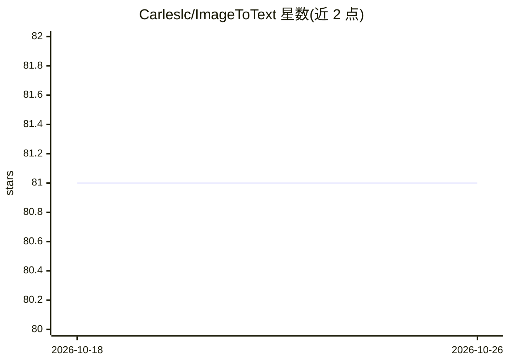

# Carleslc/ImageToText

⭐ 81 · Python · 推送 2026-02-24 · [GitHub](https://github.com/Carleslc/ImageToText) · [官网](https://carleslc.me/ImageToText) · 个人维护

**调用 Google Cloud Vision API 做图片 OCR 的命令行工具**

Python 3.6+ 编写的 img2txt 命令行脚本，封装 Google Cloud Vision API 实现图片文字检测与提取。支持本地文件、网页 URL 与 Google Cloud Storage 路径输入，可选密集文档模式、语言提示、完整描述（含逐词置信度）与置信度阈值。使用前需在 Google Cloud 建项目、启用 Vision API、开通计费并配置服务账号 JSON 凭证（文件、--key 参数或环境变量三种方式），免费额度为每月 1,000 次请求。通过 pip install -e . 从仓库源码安装，README 另提及可用 gcloud CLI 作为替代方式。

## 筛选速览

| 维度 | 判定 | 备注 |
|---|---|---|
| AI 角色 | `ai-native` | 本体是模型或模型工具 |
| 许可风险 | `none` | — |
| 部署形态 | `library` | 以包/库形式分发 |
| 模型依赖 | — | README 未给出锁定关系 |
| 硬件要求 | — | 无带数字的原话,不猜 |
| 安装摩擦 | `low` | 无编译、无系统依赖或容器化 |
| 成熟度 | — | 结构信号不足 |

## 能力要点

- 支持本地文件 / URL / Google Cloud Storage 三种图片来源
- --document 密集文档与手写识别模式，可指定语言提示
- --full 输出完整描述（块/段落/逐词置信度）

## 适用场景

- 从照片或路牌图片中提取文字
- 识别密集排版文档或手写内容并获取置信度
- 在脚本/命令行中批量做 OCR 而不写 API 代码

## 场景标签

`OCR` · 领域:感知与多模态

## 证据(README 行号)

> L3: OCR (*Optical Character Recognition*) with Google's AI technology (Cloud Vision API).
> L5: The Vision API can detect and extract text from images.

## 星数曲线

2026-10-18 81 → 2026-10-26 81（+0）

---
*卡片 v1 · prompt 1.4 · 生成 2026-10-24 · 置信度 high · 依据 README sha `806f819ea12b` · [字段定义](../../DATASET.md)*
