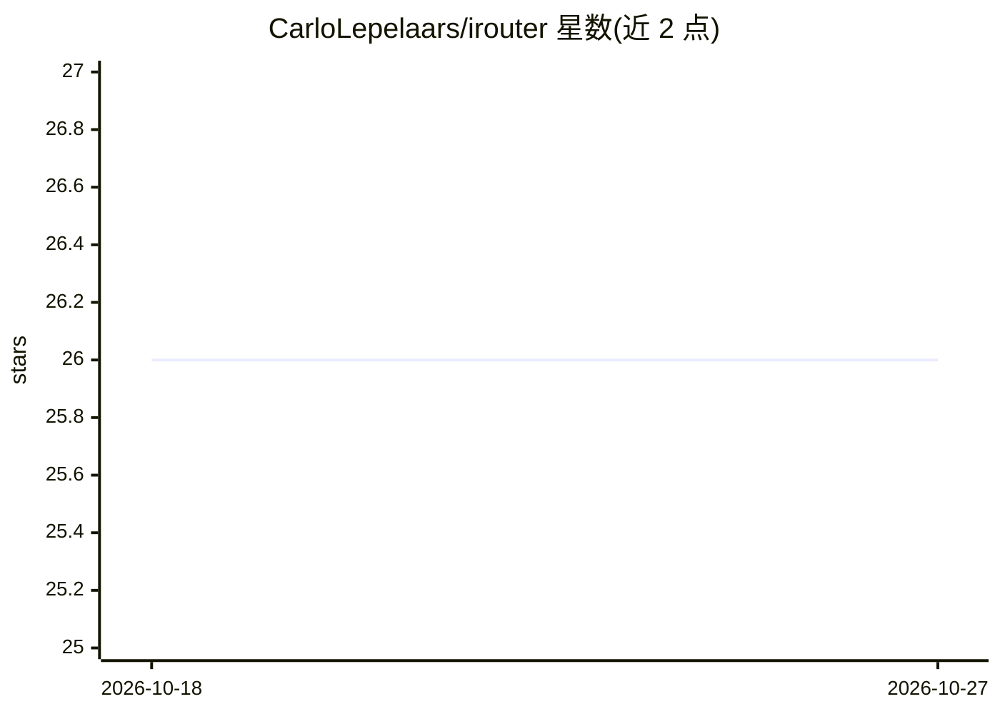

# CarloLepelaars/irouter

⭐ 26 · Jupyter Notebook · MIT · 推送 2026-04-21 · [GitHub](https://github.com/CarloLepelaars/irouter) · [官网](https://carlolepelaars.github.io/irouter/) · 个人维护

**Python 库：少量代码通过 OpenRouter 访问数百个 LLM**

基于 OpenRouter API 封装的 Python 客户端库，提供 Call（一次性交互）与 Chat（跟踪历史、token 用量、支持工具调用）两类接口，可单模型或多模型并行调用。支持文本、图片 URL/本地路径、PDF、音频（mp3/wav）输入及多模态组合请求，Chat 支持多轮函数调用（tools 参数，自动生成工具 schema）。安装为 pip install irouter，需自备 OpenRouter API key（环境变量或参数传入）。灵感来自 Answer.AI 的 cosette 与 claudette，后者扩展至数百个模型。

## 筛选速览

| 维度 | 判定 | 备注 |
|---|---|---|
| AI 角色 | `ai-ecosystem` | LLM/agent 周边工具 |
| 许可风险 | `permissive` | MIT |
| 部署形态 | `library` | 以包/库形式分发 |
| 模型依赖 | locked-api |  |
| 硬件要求 | — | 无带数字的原话,不猜 |
| 安装摩擦 | `low` | 无编译、无系统依赖或容器化 |
| 成熟度 | — | 结构信号不足 |

## 能力要点

- Call/Chat 双接口，支持单模型与多模型列表调用
- 文本/图片/PDF/音频多模态输入可在单次请求中组合
- Chat 跟踪消息历史与 token 用量，支持多轮工具调用
- get_all_models 列出 OpenRouter 上 300+ 可用模型

## 适用场景

- 在 Python 脚本或 notebook 中快速调用多家 LLM 做原型验证
- 同一问题并行发给多个模型对比输出
- 构建带工具调用和多模态输入的对话应用

## 场景标签

`多模态` `模型网关` · 领域:Agent 开发

## 证据(README 行号)

> L9: `irouter` provides a simple interface to access 100s of LLMs with minimal lines of code.
> L182: This project is built on top of the OpenRouter API infrastructure, which provides access to LLMs through a unified

## 星数曲线

2026-10-18 26 → 2026-10-27 26（+0）

---
*卡片 v1 · prompt 1.4 · 生成 2026-10-27 · 置信度 high · 依据 README sha `57fbc139d217` · [字段定义](../../DATASET.md)*
