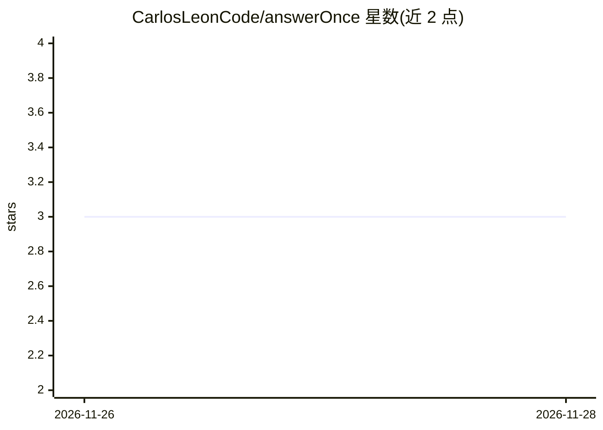

# CarlosLeonCode/answerOnce

⭐ 3 · TypeScript · AGPL-3.0 · 推送 2026-11-05 · [GitHub](https://github.com/CarlosLeonCode/answerOnce) · 个人维护

**Chromium 求职申请表自动填充扩展，资料存本地文件**

一个 Manifest V3 的隐私优先 Chrome 扩展：从用户磁盘上的纯文本文件（profile.json、documents/ 等）读取个人资料，向 Greenhouse、Lever、Ashby 及通用表单填充求职申请；支持点选 Generate with AI 生成问答题答案、从 CV（PDF/DOCX/TXT/Markdown）本地抽取并经 AI 或离线正则结构化导入档案。无后端、无遥测，从不代用户提交表单，并拒绝回答同意条款类字段。附带 applications.json 求职记录追踪与本地 MCP 服务器供 AI agent 维护档案。安装方式为下载 zip 后以未打包扩展加载，暂未上架商店。

## 筛选速览

| 维度 | 判定 | 备注 |
|---|---|---|
| AI 角色 | `ai-enhanced` | 去掉 AI 部分产品仍成立 |
| 许可风险 | `viral` | AGPL-3.0 |
| 部署形态 | `desktop` | 安装包/桌面程序 |
| 模型依赖 | local-ok | 支持本地模型 |
| 硬件要求 | — | 无带数字的原话,不猜 |
| 安装摩擦 | `low` | 无编译、无系统依赖或容器化 |
| 成熟度 | — | 结构信号不足 |

## 能力要点

- 从本地纯文本文件（profile.json）填充申请表，无后端与遥测
- 支持 Greenhouse、Lever、Ashby 及通用表单填充
- CV 本地解析（pdf.js/mammoth），AI 结构化抽取后经 zod 校验
- 内置本地 MCP 服务器 answeronce-mcp 供 Claude Code、Codex 等 agent 读写档案

## 适用场景

- 批量填写 Greenhouse/Lever/Ashby 等求职申请表
- 从已有简历 PDF 自动建立个人档案并复用
- 让 Claude Code 等 AI agent 帮助维护求职档案与申请记录
- 追踪已投递职位的申请状态历史

## 场景标签

`浏览器自动化` · 领域:效率与自动化

## 证据(README 行号)

> L12: A privacy-first Chrome extension (Manifest V3) that autofills job application forms
> L117: 4. For questions AnswerOnce could not answer, type an answer or click **Generate with AI**, review it,
> L181: You can fill and maintain your profile from an AI agent (Claude Code, Claude Desktop, Codex,

## 星数曲线

2026-11-26 3 → 2026-11-28 3（+0）

---
*卡片 v1 · prompt 1.4 · 生成 2026-11-26 · 置信度 mid · 依据 README sha `c3d0ca6526e8` · [字段定义](../../DATASET.md)*
