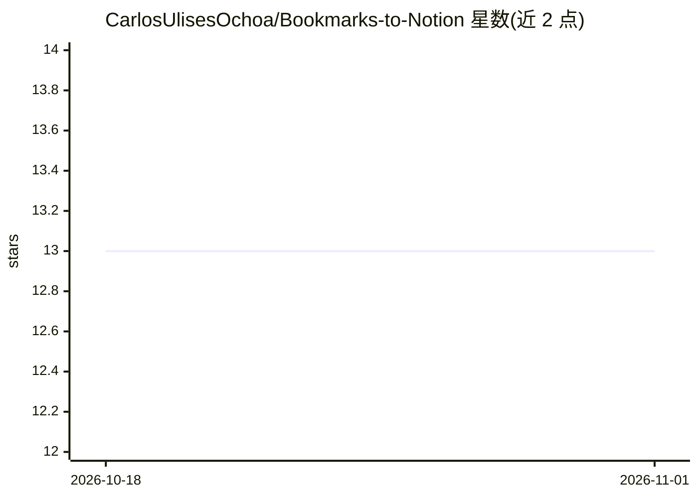

# CarlosUlisesOchoa/Bookmarks-to-Notion

⭐ 13 · Python · 推送 2026-07-12 · [GitHub](https://github.com/CarlosUlisesOchoa/Bookmarks-to-Notion) · [官网](https://carlos8a.com?ref=gh) · 个人维护

**把浏览器书签批量导入 Notion 并用 GPT 生成页面内容的 Python 脚本**

面向 Notion 用户的 Python 脚本：读取书签文件（txt/html 等任意文本格式）中的 URL 列表，用 BeautifulSoup 抓取网页，经 OpenAI GPT 模型处理后，通过 Notion API 为每个 URL 在指定数据库创建页面，页面含直链、标题与 AI 补充的描述。需配置 OPENAI_API_KEY、NOTION_API_KEY、NOTION_DB_ID 等环境变量，可选设置处理语言与 User-Agent。仅提供源码运行方式，需 Python 3.8+ 并自行申请两家账号的 API key。

## 筛选速览

| 维度 | 判定 | 备注 |
|---|---|---|
| AI 角色 | `ai-enhanced` | 去掉 AI 部分产品仍成立 |
| 许可风险 | `none` | — |
| 部署形态 | `library` | 以包/库形式分发 |
| 模型依赖 | — | README 未给出锁定关系 |
| 硬件要求 | — | 无带数字的原话,不猜 |
| 安装摩擦 | `low` | 无编译、无系统依赖或容器化 |
| 成熟度 | — | 结构信号不足 |

## 能力要点

- 从书签文件读取 URL 并为每个书签在 Notion 创建页面
- GPT 模型用于丰富页面标题与描述内容
- 支持任意文本格式的书签文件（txt/html 等）
- 通过环境变量配置，支持指定处理语言

## 适用场景

- 把浏览器书签迁移到 Notion 集中管理
- 批量将 URL 列表整理成带 AI 描述的 Notion 页面
- 为收藏的网页建立可检索的知识库条目

## 场景标签

`网页抓取` `知识库管理` · 领域:效率与自动化

## 证据(README 行号)

> L3: Bookmarks2Notion is a script designed to import your browser bookmarks into Notion. Using a combination of web scrap
> L19: Generated page content (includes direct link, title, and description enriched with AI)
> L64: - `LANGUAGE`: The language to be used when processing the scraped information with OpenAI's language model. (Option

## 星数曲线

2026-10-18 13 → 2026-11-01 13（+0）

---
*卡片 v1 · prompt 1.4 · 生成 2026-10-31 · 置信度 mid · 依据 README sha `6df94d5c8fba` · [字段定义](../../DATASET.md)*
