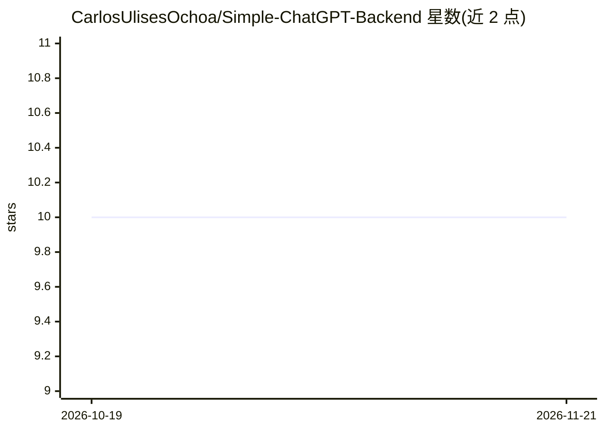

# CarlosUlisesOchoa/Simple-ChatGPT-Backend

⭐ 10 · TypeScript · 推送 2026-07-12 · [GitHub](https://github.com/CarlosUlisesOchoa/Simple-ChatGPT-Backend) · [官网](https://carlos8a.com?ref=gh) · 个人维护

**给客户端应用提供 OpenAI API 代理的后端服务**

基于 Express.js 与 TypeScript 的服务端 Node.js 应用，充当客户端应用与 OpenAI API 之间的桥接层，在服务端保管敏感 API key，避免密钥暴露到前端。转发 OpenAI API 除 stream 外的全部参数，支持通过环境变量配置默认模型、max tokens、temperature、top-p、频率/存在惩罚及 reasoning effort 等选项；OPENAI_BASE_URL 可覆盖 API 基址以接入 OpenRouter 或本地代理。需 Node.js 20.6+ 与 OpenAI API key，npm 安装依赖后启动，默认监听 3001 端口，README 提示需自行添加访问控制防止端点被滥用。

## 筛选速览

| 维度 | 判定 | 备注 |
|---|---|---|
| AI 角色 | `ai-ecosystem` | LLM/agent 周边工具 |
| 许可风险 | `none` | — |
| 部署形态 | `library` | 以包/库形式分发 |
| 模型依赖 | — | README 未给出锁定关系 |
| 硬件要求 | — | 无带数字的原话,不猜 |
| 安装摩擦 | `low` | 无编译、无系统依赖或容器化 |
| 成熟度 | — | 结构信号不足 |

## 能力要点

- 转发 OpenAI API 除 stream 外的全部参数，messages 必填其余可选
- 服务端保管 API key，避免暴露给客户端
- 环境变量配置默认模型、采样参数与日志级别
- OPENAI_BASE_URL 可指向 OpenRouter 或本地代理

## 适用场景

- 前端应用不持有 API key 即可调用 OpenAI 接口
- 统一配置默认模型与采样参数供多个客户端调用
- 通过覆盖 base URL 接入 OpenRouter 或本地代理

## 场景标签

`模型网关` · 领域:Agent 开发

## 证据(README 行号)

> L3: Simple ChatGPT Backend is a server-side Node.js application that uses Express.js. It serves as a bridge between clie
> L5: This can be useful for those who wish to utilize the OpenAI's API without the risk of exposing their secret API keys

## 星数曲线

2026-10-19 10 → 2026-11-21 10（+0）

---
*卡片 v1 · prompt 1.4 · 生成 2026-11-20 · 置信度 high · 依据 README sha `2acdda790a57` · [字段定义](../../DATASET.md)*
