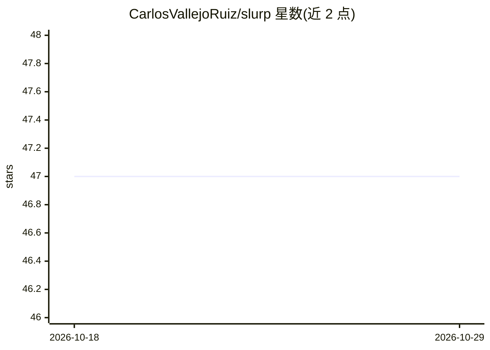

# CarlosVallejoRuiz/slurp

⭐ 47 · Python · 推送 2026-09-15 · [GitHub](https://github.com/CarlosVallejoRuiz/slurp) · 个人维护

**给 AI 编程 agent 的 token 预算感知知识图查询工具**

面向 AI 编程 agent 与开发者的 CLI：读取 graphify 生成的代码知识图（graph.json），将每个节点与查询做相关性打分，贪心选取在 token 预算内的高相关子图输出（markdown/json/yaml），可附带源码块与逐节点得分解释。支持多图联邦查询、MCP 服务器模式（slurp serve）、交互式图可视化与查询审计日志。默认 TF-IDF 打分，可选 OpenAI/Anthropic 后端；需 Python 3.12+，通过 pip/uv/pipx 安装，或作为 graphify 的伴侣工具使用。

## 筛选速览

| 维度 | 判定 | 备注 |
|---|---|---|
| AI 角色 | `ai-ecosystem` | LLM/agent 周边工具 |
| 许可风险 | `none` | — |
| 部署形态 | `desktop` | 安装包/桌面程序 |
| 模型依赖 | — | README 未给出锁定关系 |
| 硬件要求 | — | 无带数字的原话,不猜 |
| 安装摩擦 | `low` | 无编译、无系统依赖或容器化 |
| 成熟度 | — | 结构信号不足 |

## 能力要点

- 对知识图节点打分并贪心选取 token 预算内的最优子图
- MCP 服务器模式，AI 编程助手通过 slurp_query 工具查询
- 多 graph 联邦查询，节点 id 按项目命名空间自动隔离
- PageRank/Token 计数缓存与懒堆优化，端到端延迟约 10.69 ms（2,111 节点图）

## 适用场景

- 把大型代码库按 token 预算裁剪后注入 LLM 提示词
- 让 Claude Code 等 MCP 客户端通过同一工具跨多个仓库查询代码
- 审计 agent 历史查询与高频选中节点

## 场景标签

`知识图谱` · 领域:知识与检索

## 证据(README 行号)

> L12: A knowledge graph is a bowl of ramen — thousands of nodes tangled together. Your LLM doesn't need the whole bowl. S
> L222: |`--backend`|`tfidf`|Scoring backend: `tfidf` (default), `openai`, or `anthropic`.|
> L275: The MCP server federates too, so your AI assistant can query every service at once

## 星数曲线

2026-10-18 47 → 2026-10-29 47（+0）

---
*卡片 v1 · prompt 1.4 · 生成 2026-10-25 · 置信度 high · 依据 README sha `c822c400fa47` · [字段定义](../../DATASET.md)*
