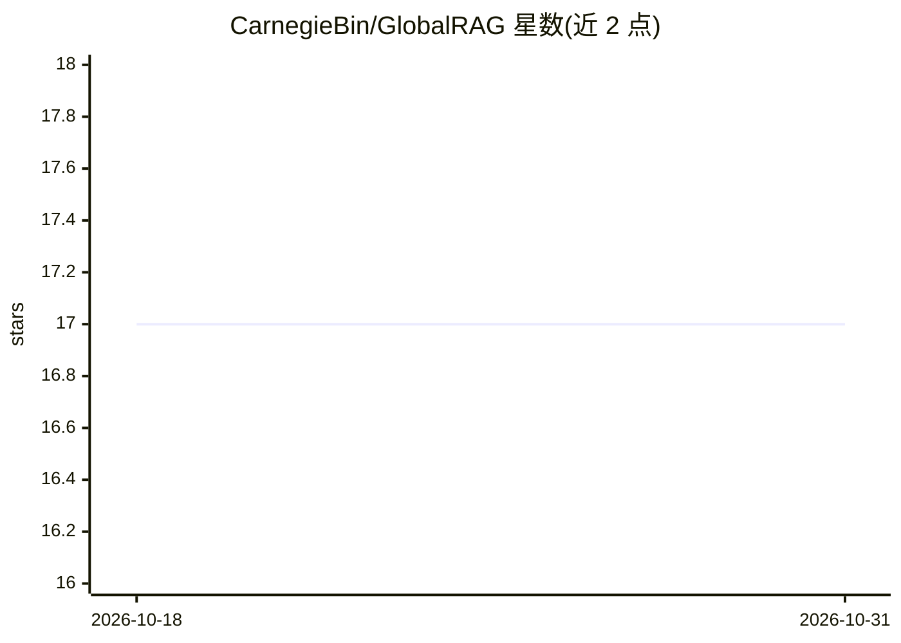

# CarnegieBin/GlobalRAG

⭐ 17 · Python · Apache-2.0 · 推送 2026-05-03 · [GitHub](https://github.com/CarnegieBin/GlobalRAG) · [官网](https://arxiv.org/pdf/2510.20548v1) · 组织维护

**强化学习框架：训练多跳问答的规划式检索推理模型**

论文官方仓库。GlobalRAG 是面向多跳问答的强化学习训练框架，基于 Search-R1 构建，将复杂问题分解为子目标并协调检索与推理，通过规划质量奖励与子目标完成奖励两种信号（经渐进权重退火）进行 GRPO 训练，模型在回答前先规划再检索。提供训练/推理脚本、开源 checkpoint 与数据，本地检索器环境为可选，支持 BM25/稠密检索及在线搜索引擎，可自定义数据集与语料。

## 筛选速览

| 维度 | 判定 | 备注 |
|---|---|---|
| AI 角色 | `ai-ecosystem` | LLM/agent 周边工具 |
| 许可风险 | `permissive` | Apache-2.0 |
| 部署形态 | `None` |  |
| 模型依赖 | local-ok | 支持本地模型 |
| 硬件要求 | — | 无带数字的原话,不猜 |
| 安装摩擦 | `low` | 无编译、无系统依赖或容器化 |
| 成熟度 | — | 结构信号不足 |

## 能力要点

- 基于 Search-R1 与 veRL/RAGEN 实现，GRPO 强化学习训练
- 规划质量奖励 + 子目标完成奖励双信号与渐进权重退火
- 支持本地稀疏/稠密检索器及在线搜索引擎（Google/Bing 等）
- 开源 checkpoint、训练与测试数据

## 适用场景

- 训练多跳问答的推理+检索 LLM
- 在 2Wiki/HotpotQA/Musique 等数据集上评测模型
- 用自己的数据集与语料库定制训练

## 场景标签

`强化学习` `RAG` · 领域:知识与检索

## 证据(README 行号)

> L3: **GlobalRAG** is a reinforcement learning framework designed for **multi-hop question answering**. It decomposes com
> L6: Built upon Search-R1, **GlobalRAG** extends its **multi-hop reasoning** capabilities with a **structured reinforceme
> L76: (4) Run RL training (GRPO) on GlobalRAG.

## 星数曲线

2026-10-18 17 → 2026-10-31 17（+0）

---
*卡片 v1 · prompt 1.4 · 生成 2026-10-30 · 置信度 high · 依据 README sha `f5ce7d840e7f` · [字段定义](../../DATASET.md)*
