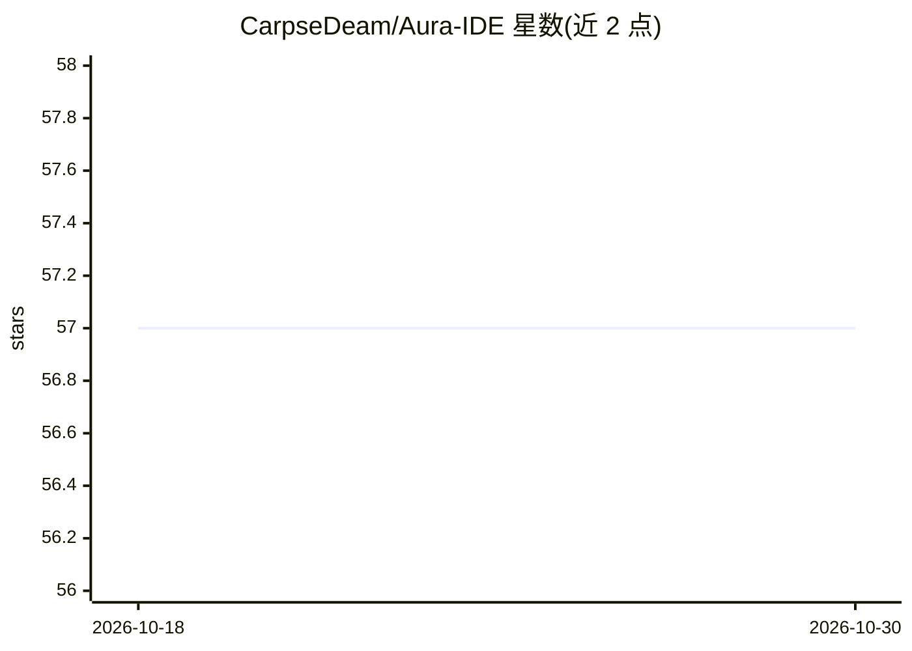

# CarpseDeam/Aura-IDE

⭐ 57 · Python · MIT · 推送 2026-09-11 · [GitHub](https://github.com/CarpseDeam/Aura-IDE) · [官网](https://carpsedeam.github.io/Aura-IDE/) · 个人维护

**面向开发者的 AI 编程桌面 IDE：多模型、Agent 团队与变更审批**

开源桌面应用（PySide6/Python），用于与 AI 协作编程：打开项目文件夹，接入托管 API（DeepSeek/OpenAI/Anthropic/Gemini/OpenRouter）或本地服务器（Ollama/LM Studio/llama.cpp），以对话方式下达编码任务。支持可复用的 Agent 与 Team 工作流（按任务编排多个 Agent、各自指定模型），提供 diff 人工审批、只读/计划模式、隔离 worktree、MCP 服务器接入与终端/Git 工具；另有手机端 Companion 通过 relay 跟进工作。Windows 提供安装包，macOS/Linux 从源码运行，MIT 许可。

## 筛选速览

| 维度 | 判定 | 备注 |
|---|---|---|
| AI 角色 | `ai-native` | 本体是模型或模型工具 |
| 许可风险 | `permissive` | MIT |
| 部署形态 | `desktop` | 安装包/桌面程序 |
| 模型依赖 | local-ok | 支持本地模型 |
| 硬件要求 | — | 无带数字的原话,不猜 |
| 安装摩擦 | `low` | 无编译、无系统依赖或容器化 |
| 成熟度 | — | 结构信号不足 |

## 能力要点

- 托管 API 与本地服务器（Ollama/LM Studio/llama.cpp）双通道接入，可在同一 Team 混用
- 可保存的 Agent 与 Team 工作流，图形式编排各 Agent 的任务与模型
- diff 人工审批、只读/计划模式、Agent 工作使用隔离 worktree
- 支持 MCP 服务器接入及内置 Git/终端工具

## 适用场景

- 在本地项目里用对话让 AI 直接完成实现、测试与审查的编码任务
- 把固定流程（实现→测试→审查）保存为可复用工作流反复运行
- 混合使用托管模型与本地模型，并对 AI 改动逐 diff 审批

## 场景标签

`编码 Agent` · 领域:编码与开发

## 证据(README 行号)

> L5: Aura is an open-source desktop app for coding with AI. Open a project, choose a hosted or local model, and describe 
> L60: |Hosted APIs|DeepSeek, OpenAI, Anthropic, Gemini, OpenRouter|

## 星数曲线

2026-10-18 57 → 2026-10-30 57（+0）

---
*卡片 v1 · prompt 1.4 · 生成 2026-10-24 · 置信度 high · 依据 README sha `56f3203d2790` · [字段定义](../../DATASET.md)*
