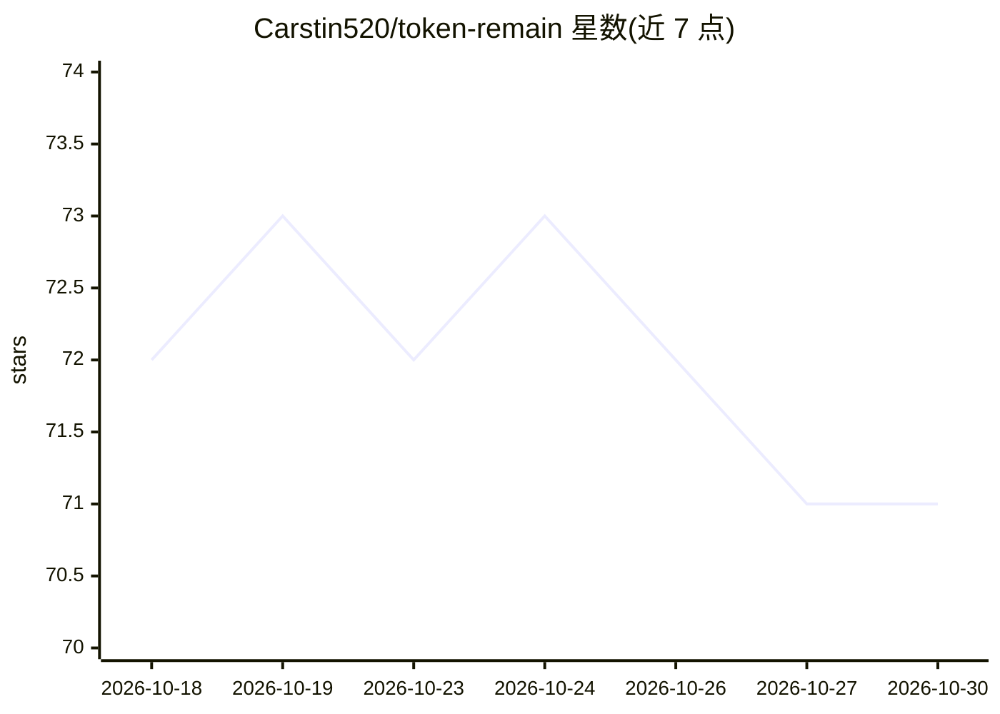

# Carstin520/token-remain

⭐ 71 · Swift · Apache-2.0 · 推送 2026-10-27 · [GitHub](https://github.com/Carstin520/token-remain) · [官网](https://tokenremain.com) · 个人维护 · 中文 README

**macOS 菜单栏应用：追踪 21+ 家 AI 编码工具的剩余额度与 Token 成本**

面向使用 AI 编码工具的开发者的 macOS 菜单栏与 Dashboard 应用：只读本机已有凭证（不刷新、不上传），从各服务商官方 API 读取剩余额度、重置倒计时，并用内置 ccusage 离线统计 15+ 种本地编码 Agent 的 Token 用量与估算成本，支持多账号、13 种显示币种、从会话日志估算各模型 tok/s。覆盖 Claude Code、Codex、Cursor、Grok、OpenRouter、Ollama 等 21+ 家工具。以 DMG 安装包分发，需 macOS 14+；iPhone 版为 TestFlight 测试且移动端源码未开源。

## 筛选速览

| 维度 | 判定 | 备注 |
|---|---|---|
| AI 角色 | `ai-enhanced` | 去掉 AI 部分产品仍成立 |
| 许可风险 | `permissive` | Apache-2.0 |
| 部署形态 | `desktop` | 安装包/桌面程序 |
| 模型依赖 | local-ok | 支持本地模型 |
| 硬件要求 | — | 无带数字的原话,不猜 |
| 安装摩擦 | `low` | 无编译、无系统依赖或容器化 |
| 成熟度 | `idea` | |

## 能力要点

- 21+ 家工具的剩余额度、重置倒计时与节奏预测
- 内置 ccusage 离线统计本地 Agent 的 Token 构成与成本估算
- 凭证只读本机、不刷新、不上传，密钥存 macOS 钥匙串
- 多账号管理与可选 iCloud 端到端加密同步（默认关闭）

## 适用场景

- 同时在多家 AI 编码工具订阅下查看剩余额度与重置时间
- 统计本地 Claude Code / Codex 会话的 Token 用量与估算成本
- 多账号场景下分行监控同一工具的不同账号额度

## 场景标签

 · 领域:桌面工具/AI 用量监控

## 证据(README 行号)

> L5: **AI 编码工具的剩余额度，常驻 Mac 菜单栏。**
> L41: - **今日成本**：内置 ccusage 离线统计 15+ 种本地编码 Agent（含 Claude Desktop / Cowork），按官方 API 标价估算。

## 星数曲线

2026-10-18 72 → 2026-10-30 71（-1）

---
*卡片 v1 · prompt 1.4 · 生成 2026-10-24 · 置信度 high · 依据 README sha `5e17958f0ebe` · [字段定义](../../DATASET.md)*
