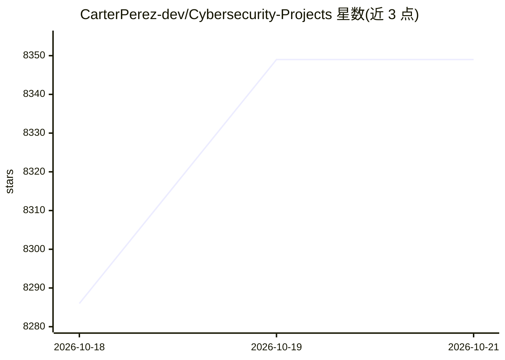

# CarterPerez-dev/Cybersecurity-Projects

⭐ 8,349 · Go · AGPL-3.0 · 推送 2026-10-14 · [GitHub](https://github.com/CarterPerez-dev/Cybersecurity-Projects) · [官网](https://certgames.com) · 个人维护

**网络安全学习项目清单：70 个分级实战项目与认证路线图**

面向网络安全学习者的项目聚合仓库：收录 70 个从 Foundations（零基础）到 Advanced 四级难度的实战项目，涵盖端口扫描、密码管理器、SIEM 面板、SBOM 生成器、加密聊天等，多为 Python/Go/Rust/C++ 源码，附学习要点与时长估计。另提供 10 条认证路线图（SOC 分析师、渗透测试等）与学习资源索引。项目可作学习参考或直接复制使用。

## 筛选速览

| 维度 | 判定 | 备注 |
|---|---|---|
| AI 角色 | `ai-knowledge` | 知识聚合/清单类 |
| 许可风险 | `viral` | AGPL-3.0 |
| 部署形态 | `library` | 以包/库形式分发 |
| 模型依赖 | — | README 未给出锁定关系 |
| 硬件要求 | — | 无带数字的原话,不猜 |
| 安装摩擦 | `medium` | 含编译或系统依赖之一 |
| 成熟度 | — | 结构信号不足 |

## 能力要点

- 70 个项目按 Foundations/Beginner/Intermediate/Advanced 四级组织
- 每条目给出时长、技术栈与所学知识点
- 附 10 条认证路线图与学习资源索引
- Foundations 级面向无编程经验者，源码带教学注释与 learn/ 文件夹

## 适用场景

- 按难度递进地练习编写安全工具
- 备考 SOC 分析师、渗透测试等认证时找路线图
- 找可复用的安全工具源码作参考

## 场景标签

`网络安全` `精选清单` · 领域:学习与行业

## 证据(README 行号)

> L3:  70 Cybersecurity Projects, Certification Roadmaps & Resources
> L38: Hands-on cybersecurity projects with full source code, organized in four tiers — **Foundations** (pre-beginner, fir

## 星数曲线

2026-10-18 8,286 → 2026-10-21 8,349（+63）

---
*卡片 v1 · prompt 1.4 · 生成 2026-10-20 · 置信度 mid · 依据 README sha `1f51f74a0895` · [字段定义](../../DATASET.md)*
