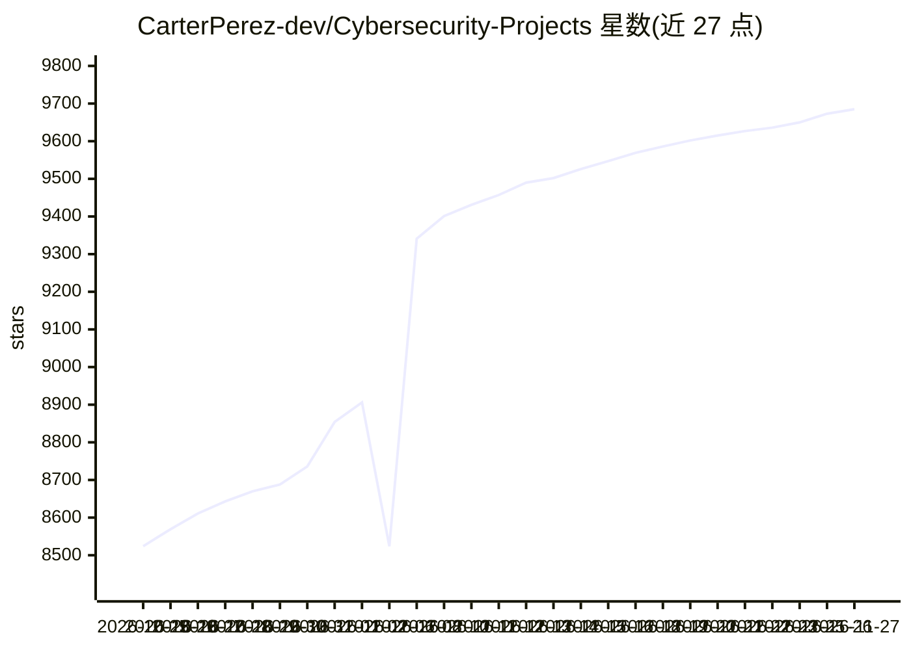

# CarterPerez-dev/Cybersecurity-Projects

⭐ 9,685 · Go · AGPL-3.0 · 推送 2026-11-20 · [GitHub](https://github.com/CarterPerez-dev/Cybersecurity-Projects) · [官网](https://angelamos.com) · 个人维护

**为网络安全学习者提供 70 个分级实战项目与认证路线图**

面向网络安全学习者的项目合集仓库：收录 70 个带完整源码的实战项目，按 Foundations（零基础）、Beginner、Intermediate、Advanced 四级组织，每个项目标注耗时、语言与知识点；另提供 SOC Analyst、Pentester、Security Engineer 等 10 条认证路线图及工具/课程/社区学习资源。项目源码附带教学注释与 learn/ 概念讲解文件夹，涵盖哈希破解、端口扫描、SIEM、密钥检测等方向，商业推广指向维护者自有平台 CertGames。

## 筛选速览

| 维度 | 判定 | 备注 |
|---|---|---|
| AI 角色 | `ai-knowledge` | 知识聚合/清单类 |
| 许可风险 | `viral` | AGPL-3.0 |
| 部署形态 | `library` | 以包/库形式分发 |
| 模型依赖 | — | README 未给出锁定关系 |
| 硬件要求 | — | 无带数字的原话,不猜 |
| 安装摩擦 | `medium` | 含编译或系统依赖之一 |
| 成熟度 | — | 结构信号不足 |

## 能力要点

- 70 个分级项目含完整源码、学习要点与文档
- Foundations 级面向首次编程者，源码逐行注释教学
- 10 条结构化认证职业路线图（SOC/渗透/安全工程等）
- 项目横跨 Python/C++/Go/Rust/Nim/Crystal 等语言

## 适用场景

- 按分级路线系统学习网络安全工具开发
- 为求职作品集寻找可参考或复用的安全项目
- 规划 SOC 分析师/渗透测试员等认证路径

## 场景标签

`网络安全` `教程课程` · 领域:学习与行业

## 证据(README 行号)

> L3:  70 Cybersecurity Projects, Certification Roadmaps & Resources
> L37: Hands-on cybersecurity projects with full source code, organized in four tiers — **Foundations** (pre-beginner, fir
> L43: Tools, courses, certifications, communities, and frameworks for cybersecurity professionals.

## 星数曲线

2026-10-25 8,524 → 2026-11-27 9,685（+1,161）

---
*卡片 v1 · prompt 1.4 · 生成 2026-11-22 · 置信度 mid · 依据 README sha `4b4df02d3740` · [字段定义](../../DATASET.md)*
