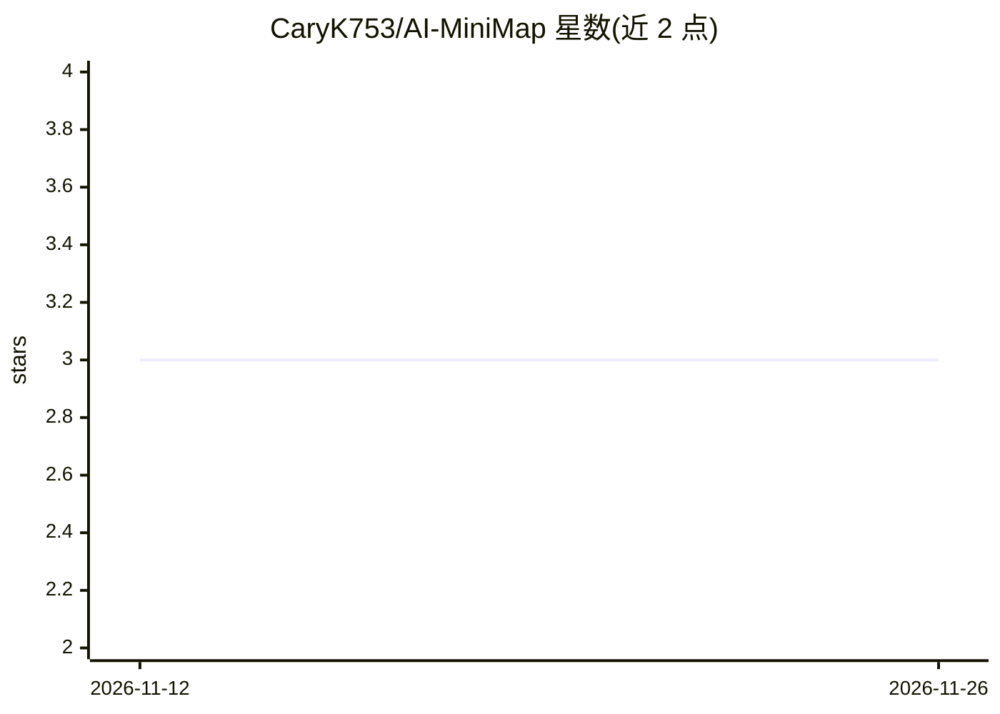

# CaryK753/AI-MiniMap

⭐ 3 · JavaScript · MIT · 推送 2026-11-13 · [GitHub](https://github.com/CaryK753/AI-MiniMap) · 个人维护 · 中文 README

**为 ChatGPT 等聊天网站添加迷你地图导航与导出的浏览器扩展**

浏览器扩展，为 ChatGPT、Gemini、Claude、DeepSeek 四个网页端聊天平台提供悬浮导航条：按提示词跳转并高亮、通过页面滚动加载机制收集更早历史消息、逐条筛选后导出 TXT/Markdown/JSON。支持 Chrome/Edge、Firefox、Safari（含原生承载应用），亮暗主题与中英双语。使用原生 JavaScript 和 Manifest V3，无运行时依赖；不上传聊天内容、不调用 AI API。网站改版后适配可能需要调整。

## 筛选速览

| 维度 | 判定 | 备注 |
|---|---|---|
| AI 角色 | `ai-enhanced` | 去掉 AI 部分产品仍成立 |
| 许可风险 | `permissive` | MIT |
| 部署形态 | `library` | 以包/库形式分发 |
| 模型依赖 | — | README 未给出锁定关系 |
| 硬件要求 | — | 无带数字的原话,不猜 |
| 安装摩擦 | `low` | 无编译、无系统依赖或容器化 |
| 成熟度 | — | 结构信号不足 |

## 能力要点

- 悬浮导航条按提示词跳转，支持无提示词时按 AI 回复导航
- 读取更早历史消息并显示进度，每轮约三分钟可继续
- 逐条筛选消息导出 TXT、Markdown 或 JSON
- 支持 Chrome/Edge、Firefox 140+、Safari 及 Safari 原生应用

## 适用场景

- 在超长 AI 对话中快速定位某条提示词
- 把与 AI 的聊天记录导出为 Markdown 存档
- 给多平台 AI 聊天网页加统一的对话导航

## 场景标签

 · 领域:浏览器扩展/效率工具

## 证据(README 行号)

> L5: 为 ChatGPT、Gemini、Claude 和 DeepSeek 提供轻量的对话导航与导出工具。通过悬浮展开的导航条快速定位提示词，读取更早的消息，并将所选内容保存为文件。
> L71: 扩展使用原生 JavaScript 和 Manifest V3，无运行时依赖。测试需要 Node.js 20+、Python 3 和 Playwright；Safari 原生构建还需要 macOS 与兼容的 Xcode。

## 星数曲线

2026-11-12 3 → 2026-11-26 3（+0）

---
*卡片 v1 · prompt 1.4 · 生成 2026-11-22 · 置信度 high · 依据 README sha `86eb18e44683` · [字段定义](../../DATASET.md)*
