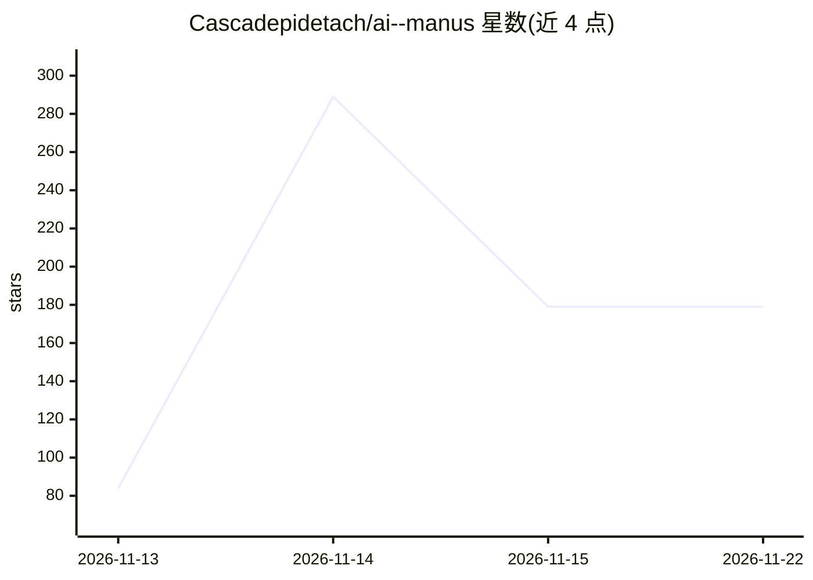

# Cascadepidetach/ai--manus

⭐ 179 · Apache-2.0 · 推送 2026-11-15 · [GitHub](https://github.com/Cascadepidetach/ai--manus) · 个人维护

**面向个人用户的自主 AI Agent：代写代码并操控浏览器**

Manus 是一个自主 AI Agent，代替用户执行代码与浏览器操作：可编写并运行脚本、打开网页、填写表单、执行多步骤任务，代码执行与浏览器控制可在同一流程内衔接。定位为家庭、学习与轻量办公场景的个人助手，不面向企业平台。README 以功能介绍与使用建议为主，给出硬件兼容表（最低 4GB 内存、双核 CPU），但未提供安装命令、代码仓库结构、模型接入方式等可验证的实现细节，全文呈营销式描述。

## 筛选速览

| 维度 | 判定 | 备注 |
|---|---|---|
| AI 角色 | `ai-native` | 本体是模型或模型工具 |
| 许可风险 | `permissive` | Apache-2.0 |
| 部署形态 | `None` |  |
| 模型依赖 | — | README 未给出锁定关系 |
| 硬件要求 | — | 无带数字的原话,不猜 |
| 安装摩擦 | `low` | 无编译、无系统依赖或容器化 |
| 成熟度 | — | 结构信号不足 |

## 能力要点

- 自主执行代码与浏览器控制（导航网页、填表单、采集信息）
- 代码与浏览器操作可在同一多步骤任务流程中衔接
- 面向家庭/学习/轻办公的小规模任务自动化

## 适用场景

- 让 agent 代跑小脚本和快速实验
- 自动浏览多个网页收集资料并汇总
- 处理重复性小任务（整理文件、检查页面更新）

## 场景标签

`AI 助手` `编码 Agent` `浏览器自动化` · 领域:效率与自动化

## 证据(README 行号)

> L18: Manus is an autonomous AI agent designed to run code and control a browser on your behalf. Instead of acting like a
> L22: Manus is not a heavy studio suite or a complex enterprise platform. It is a focused helper built for home, study, a

## 星数曲线

2026-11-13 84 → 2026-11-22 179（+95）

---
*卡片 v1 · prompt 1.4 · 生成 2026-11-17 · 置信度 low · 依据 README sha `0f78ee3a5dd2` · [字段定义](../../DATASET.md)*
