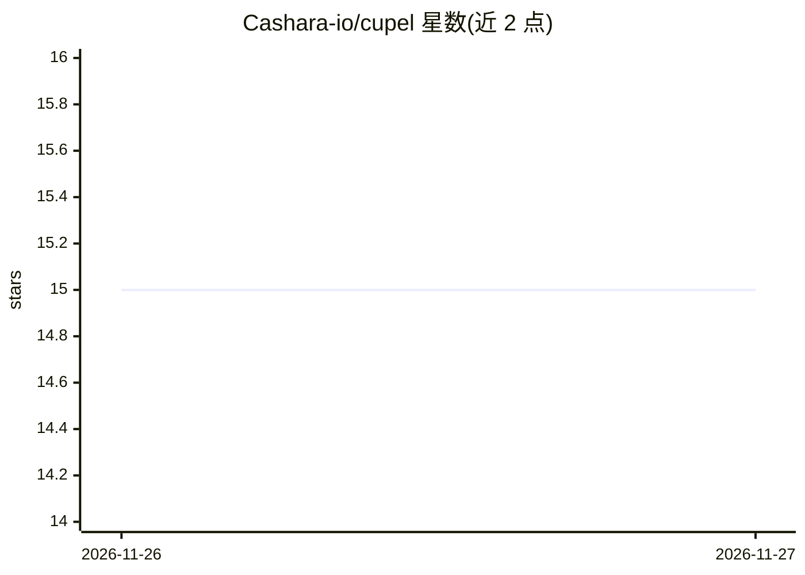

# Cashara-io/cupel

⭐ 15 · Rust · MIT · 推送 2026-11-26 · [GitHub](https://github.com/Cashara-io/cupel) · [官网](https://www.buildpaperless.com.au/eunomia) · 组织维护

**自托管的 AI agent 共享记忆库：通过 MCP/REST 供各 AI 应用查询**

自托管的服务，将人员、事实、决策与文档存入 vault（记忆空间），供已连接的 ChatGPT、Claude、Claude Code、Codex 等 AI 应用经 MCP 或 REST 读写与检索，支持语义、关键词与图搜索。提供 Web 界面、记忆空间共享与权限控制、文档上传、GitHub/Slack/Notion 等来源导入、审计日志与加密备份。AI 模型为可选：不配置也能用文本检索，配置 OpenAI 兼容端点后开启语义搜索、实体抽取与站内聊天。许可证为 PolyForm Noncommercial，商用需付费许可。

## 筛选速览

| 维度 | 判定 | 备注 |
|---|---|---|
| AI 角色 | `ai-ecosystem` | LLM/agent 周边工具 |
| 许可风险 | `none` | MIT |
| 部署形态 | `desktop` | 安装包/桌面程序 |
| 模型依赖 | local-ok | 支持本地模型 |
| 硬件要求 | — | 无带数字的原话,不猜 |
| 安装摩擦 | `low` | 无编译、无系统依赖或容器化 |
| 成熟度 | `idea` | |

## 能力要点

- vault 记忆空间：个人/共享空间、跨实例加密同步、空间合并与复制
- 经 MCP 或 REST 接入多个 AI 应用，支持语义、关键词与图搜索
- 内置 GitHub、Slack、Notion、Gmail 等来源导入与文件上传检索
- 审计日志、agent token 范围限制、夜间加密备份与 OIDC 单点登录

## 适用场景

- 让团队多个 AI 应用共享同一份人员与项目记忆
- 把散落在 Slack/Notion/GitHub 的信息导入供 agent 检索
- 自托管环境下控制哪些 agent 能读写哪些记忆空间

## 场景标签

`Agent 记忆` `语义搜索` `知识图谱` · 领域:Agent 开发

## 证据(README 行号)

> L15: **Shared memory for the AI apps you already use.**
> L245: **You don't need one.** Connected AI apps use their own model to read and write
> L246: memories, and Cupel's search works on text and links. Adding an OpenAI-compatible

## 星数曲线

2026-11-26 15 → 2026-11-27 15（+0）

---
*卡片 v1 · prompt 1.4 · 生成 2026-11-26 · 置信度 high · 依据 README sha `c9d58a899bb1` · [字段定义](../../DATASET.md)*
