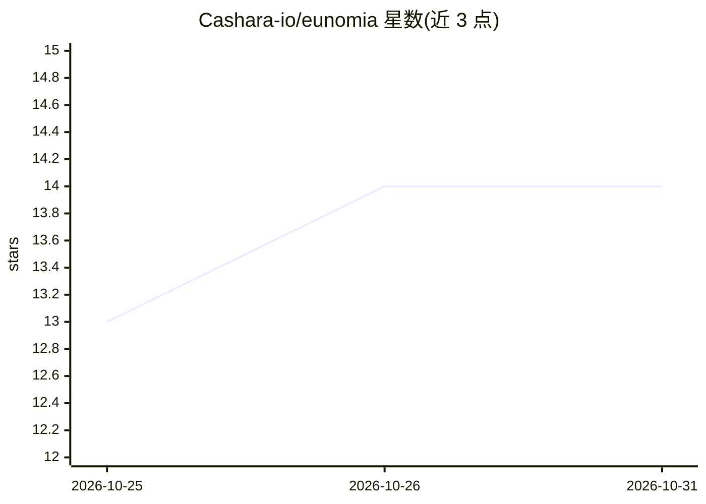

# Cashara-io/eunomia

⭐ 14 · Rust · NOASSERTION · 推送 2026-10-28 · [GitHub](https://github.com/Cashara-io/eunomia) · [官网](https://www.buildpaperless.com.au/eunomia) · 组织维护

**自托管的 AI agent 共享记忆服务：按 vault 存取人物、事实与决策**

自托管记忆服务，以 vault（个人/项目/团队）为组织与共享单元，agent 通过 MCP 或 REST 读写记忆。检索结合语义、关键词、图链接与日期范围五条路径并用 RRF 融合。每个 org 独立 SurrealDB 数据库，token 可限定 vault 与有效期，工具调用有审计日志。可从 Up Bank、GitHub、Slack 等 12 类来源同步记录；语义检索与实体抽取需自行配置 OpenAI 兼容端点，写入与基本检索无需模型 key。许可证为 PolyForm Noncommercial。

## 筛选速览

| 维度 | 判定 | 备注 |
|---|---|---|
| AI 角色 | `ai-ecosystem` | LLM/agent 周边工具 |
| 许可风险 | `none` | NOASSERTION |
| 部署形态 | `self-host` | docker 或自建部署 |
| 模型依赖 | — | README 未给出锁定关系 |
| 硬件要求 | — | 无带数字的原话,不猜 |
| 安装摩擦 | `low` | 无编译、无系统依赖或容器化 |
| 成熟度 | — | 结构信号不足 |

## 能力要点

- vault 为单元的记忆组织、邀请共享、克隆与合并（实体折叠去重）
- MCP + REST 双通道，token 可限定单 vault 并设过期
- 每 org 独立数据库隔离，夜间加密备份与恢复演练
- 12 类数据源连接器同步记录，AES-256-GCM 加密存储密钥

## 适用场景

- 让多个 agent 会话之间保留项目与客户的事实记忆
- 团队共享一个项目 vault，统一记忆图谱
- 把 GitHub/Notion/Slack 等来源记录与记忆一同检索

## 场景标签

`Agent 记忆` `知识图谱` · 领域:Agent 开发

## 证据(README 行号)

> L36: Eunomia is a self-hosted memory service built around **vaults**: separate
> L37: spaces for the knowledge your agents read and update over MCP or REST.
> L161: The installer supports Claude Code, Codex, Hermes, Gemini CLI, Cursor,

## 星数曲线

2026-10-25 13 → 2026-10-31 14（+1）

---
*卡片 v1 · prompt 1.4 · 生成 2026-10-31 · 置信度 high · 依据 README sha `81a37af4d6ca` · [字段定义](../../DATASET.md)*
