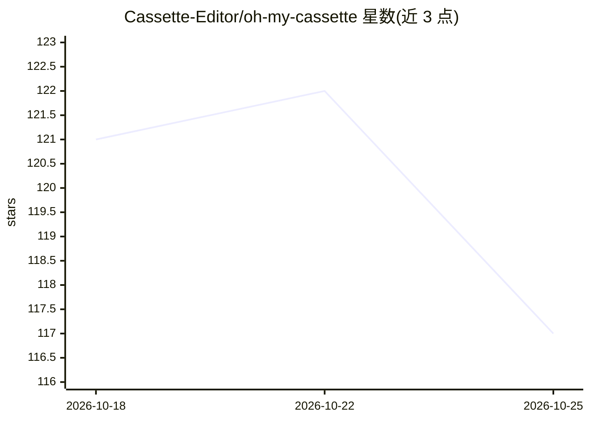

# Cassette-Editor/oh-my-cassette

⭐ 118 · Python · MIT · 推送 2026-10-22 · [GitHub](https://github.com/Cassette-Editor/oh-my-cassette) · [官网](https://cassette-editor.github.io/oh-my-cassette/) · 组织维护 · 中文 README

**让 Claude Code/Codex 等编码 agent 对话式剪辑视频的 MCP 桥接插件**

发布在 PyPI 上的本地 stdio MCP server（uvx 运行），把 Claude Code、Codex、OpenCode、Hermes 等编码 agent 连接到 Cassette MCP 云端剪辑服务：编辑工具（项目、剪辑轮次、撤销、导出）由服务侧提供并随服务更新；桥接层负责本机媒体准备——用 ffmpeg 转码视频、分片并行上传（仅限工作区内媒体文件），导出文件下载到 cassette-exports/。需受邀 Cassette 账号、uv 0.5+、ffmpeg；云端项目闲置三天后连同媒体被删除。

## 筛选速览

| 维度 | 判定 | 备注 |
|---|---|---|
| AI 角色 | `ai-ecosystem` | LLM/agent 周边工具 |
| 许可风险 | `permissive` | MIT |
| 部署形态 | `library` | 以包/库形式分发 |
| 模型依赖 | — | README 未给出锁定关系 |
| 硬件要求 | — | 无带数字的原话,不猜 |
| 安装摩擦 | `medium` | 含编译或系统依赖之一 |
| 成熟度 | — | 结构信号不足 |

## 能力要点

- 本地 stdio MCP 桥接，工具列表随 Cassette 服务更新而变化
- 本机 ffmpeg 转码、四路并行分片上传与断点续传
- 受限等待与 preparing 后台续作，长任务不超时宿主
- 附 check 命令按 contract v1 校验兼容的 MCP 服务

## 适用场景

- 在 Claude Code/Codex 会话里用自然语言导入素材并生成短视频
- 对 AI 生成的剪辑提出修改意见并导出 MP4
- 为自建或第三方 Cassette MCP 服务做契约兼容性检查

## 场景标签

`视频生成` · 领域:内容生成

## 证据(README 行号)

> L5:  Edit video by talking to the Cassette agent from Claude Code, Codex, OpenCode or Hermes.
> L6:  A small MCP bridge on PyPI. The editing tools come from the Cassette MCP service, so they stay current without a pl
> L78: Oh My Cassette connects your coding agent to the Cassette editing agent. It is a local stdio MCP server

## 星数曲线

2026-10-18 121 → 2026-10-25 117（-4）

---
*卡片 v1 · prompt 1.4 · 生成 2026-10-23 · 置信度 high · 依据 README sha `9b6f193d2633` · [字段定义](../../DATASET.md)*
