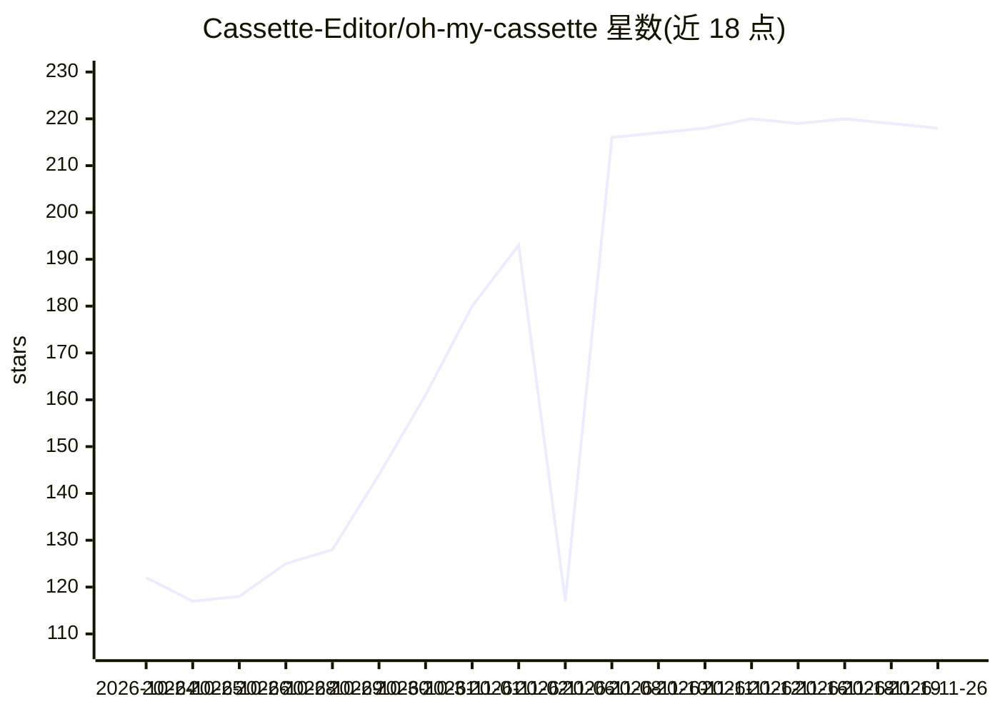

# Cassette-Editor/oh-my-cassette

⭐ 218 · Python · MIT · 推送 2026-11-22 · [GitHub](https://github.com/Cassette-Editor/oh-my-cassette) · [官网](https://cassette-editor.github.io/oh-my-cassette/) · 组织维护 · 中文 README

**把 Claude Code 等编程代理接入 Cassette 云端视频剪辑服务的 MCP 桥**

一个以 stdio 运行的本地 MCP 服务器，把 Claude Code、Codex、OpenCode、Hermes 等编程代理连接到 Cassette 编辑代理：本仓库只做桥接，剪辑工具清单、撤销、导出等由远端 Cassette MCP 服务动态下发，插件无需随服务更新发版。本地部分负责把工作区内的视频/音频/图像用 ffmpeg 转码、分块并发上传，导出文件下载到 cassette-exports/；支持云端项目（闲置三天删除）与由 Cassette for Mac 托管的项目两种保留策略。需受邀请的 Cassette 账号，凭 uvx 从 PyPI 运行。

## 筛选速览

| 维度 | 判定 | 备注 |
|---|---|---|
| AI 角色 | `ai-ecosystem` | LLM/agent 周边工具 |
| 许可风险 | `permissive` | MIT |
| 部署形态 | `library` | 以包/库形式分发 |
| 模型依赖 | — | README 未给出锁定关系 |
| 硬件要求 | — | 无带数字的原话,不猜 |
| 安装摩擦 | `medium` | 含编译或系统依赖之一 |
| 成熟度 | — | 结构信号不足 |

## 能力要点

- 本地 stdio MCP 桥，工具清单由远端服务动态下发
- ffmpeg 本地转码后分块并发上传，断点续传
- 支持 Claude Code/Codex/OpenCode/Hermes 及任意 MCP 主机
- 可用自有 OpenAI key 支付剪辑代理调用

## 适用场景

- 在 Claude Code 会话里导入多段影片并让代理剪出预告片
- 用对话方式修改镜头、配乐节奏并导出成片
- 把本地素材上传到云端项目或 Mac 托管项目进行剪辑

## 场景标签

`视频生成` · 领域:内容生成

## 证据(README 行号)

> L80: Oh My Cassette connects your coding agent to the Cassette editing agent. It is a local stdio MCP server
> L84: Claude Code / Codex / OpenCode / Hermes  ──stdio──▶  oh-my-cassette  ──HTTP──▶  Cassette MCP service  ──▶  Cassette
> L116: - uv 0.5 or newer. `uvx oh-my-cassette==0.7.5` resolves Python 3.11 or newer by itself.

## 星数曲线

2026-10-24 122 → 2026-11-26 218（+96）

---
*卡片 v1 · prompt 1.4 · 生成 2026-11-25 · 置信度 high · 依据 README sha `4f3de5ceb18d` · [字段定义](../../DATASET.md)*
