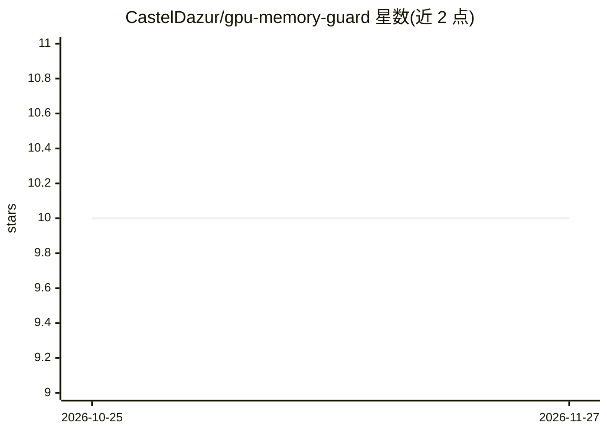

# CastelDazur/gpu-memory-guard

⭐ 10 · Python · MIT · 推送 2026-11-24 · [GitHub](https://github.com/CastelDazur/gpu-memory-guard) · [官网](https://castel.studio) · 个人维护

**加载模型前检查 NVIDIA 显存是否够用的 CLI 工具**

一个在加载模型前检查 NVIDIA GPU 空闲显存的命令行工具：将空闲显存与模型大小加安全缓冲区比较，通过终端消息或退出码（0/1/2）告知模型是否可能装得下。供脚本在推理前做预检，以便提前选择更小的模型或等待显存释放。同时提供 Python 库接口（can_load_model/check_vram 等函数）与 --json 输出。工具仅做预估报告，不预留显存，也不阻止其他进程占用；仅支持 NVIDIA GPU。

## 筛选速览

| 维度 | 判定 | 备注 |
|---|---|---|
| AI 角色 | `ai-ecosystem` | LLM/agent 周边工具 |
| 许可风险 | `permissive` | MIT |
| 部署形态 | `library` | 以包/库形式分发 |
| 模型依赖 | — | README 未给出锁定关系 |
| 硬件要求 | — | 无带数字的原话,不猜 |
| 安装摩擦 | `medium` | 含编译或系统依赖之一 |
| 成熟度 | — | 结构信号不足 |

## 能力要点

- 以退出码（0/1/2）输出判定结果，便于脚本分支处理
- 支持 --model-size/--buffer/--json 参数与 Python 库调用
- 附 GPU/模型/量化尺寸参考表与 CUDA OOM 排错文档
- 依赖 pynvml 或 nvidia-smi 查询显存，Python 3.8+

## 适用场景

- 脚本启动推理前预检显存，避免 OOM 或 GPU 卡死
- 多模型场景下自动改选更小的模型或量化版本
- 通过 --json 获取各 GPU 空闲显存与 can_fit 判定

## 场景标签

 · 领域:AI 基础设施/运维工具

## 证据(README 行号)

> L7: A small CLI that checks free NVIDIA GPU memory before you load a model. It compares free VRAM with the model size pl
> L13: Loading a model that does not fit can end in an out-of-memory error, a hung GPU or, on some desktop setups, a froze

## 星数曲线

2026-10-25 10 → 2026-11-27 10（+0）

---
*卡片 v1 · prompt 1.4 · 生成 2026-11-20 · 置信度 high · 依据 README sha `d84375cfef5e` · [字段定义](../../DATASET.md)*
