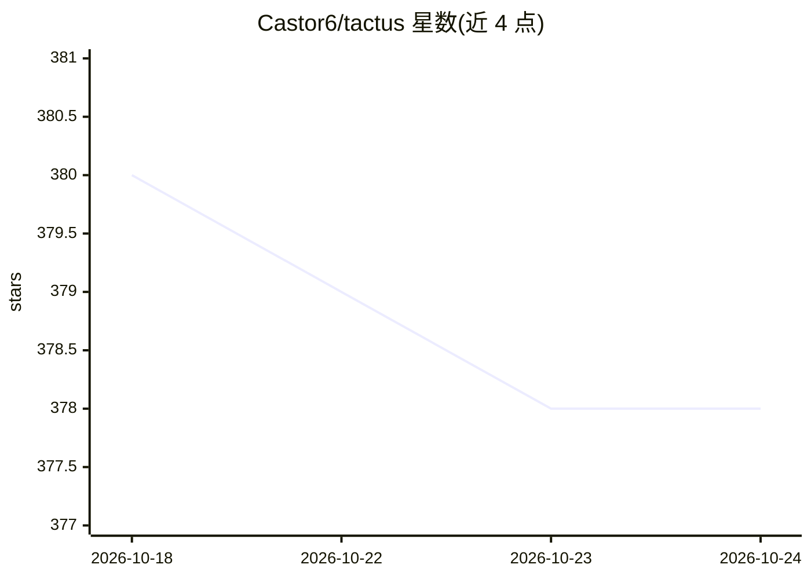

# Castor6/tactus

⭐ 378 · TypeScript · Apache-2.0 · 推送 2026-05-10 · [GitHub](https://github.com/Castor6/tactus) · [官网](https://tactus.cc.cd/) · 个人维护 · 中文 README

**支持 Agent Skills 的浏览器 AI Agent 扩展**

基于 WXT + Vue 3 + TypeScript 的浏览器扩展（Chrome/Firefox），在浏览器侧实现 Agent Skills 规范：可导入含 SKILL.md 的技能文件夹、在页面内安全执行 JavaScript 脚本、内置 extract_page_content 等工具，并支持接入多个 HTTP MCP Server（Bearer Token / OAuth 2.1 认证）动态扩展工具。对话部分原生支持 Anthropic、Gemini 及任意 OpenAI 兼容 API，多模型切换、流式输出、ReAct 工具调用循环、视觉模型配置与页面内容 Markdown 提取；所有会话与技能数据存储在本地 IndexedDB，不上传服务器。脚本首次执行需用户确认。

## 筛选速览

| 维度 | 判定 | 备注 |
|---|---|---|
| AI 角色 | `ai-native` | 本体是模型或模型工具 |
| 许可风险 | `permissive` | Apache-2.0 |
| 部署形态 | `library` | 以包/库形式分发 |
| 模型依赖 | locked-api |  |
| 硬件要求 | — | 无带数字的原话,不猜 |
| 安装摩擦 | `low` | 无编译、无系统依赖或容器化 |
| 成熟度 | — | 结构信号不足 |

## 能力要点

- 在浏览器扩展中实现 Agent Skills 规范（导入 SKILL.md 技能文件夹、页面内执行脚本）
- 原生接入 Anthropic / Gemini / OpenAI 兼容 API，支持多模型切换与流式输出
- HTTP MCP Server 连接与动态工具发现（无认证 / Bearer Token / OAuth 2.1）
- 页面内容 Readability+Turndown 提取，会话与技能数据全部本地存储

## 适用场景

- 在浏览器侧边栏与 AI 对话并让它理解/操作当前网页
- 导入自定义技能文件夹，用脚本封装重复的自动化流程
- 通过 MCP Server 接入外部工具扩展 AI 能力

## 场景标签

`聊天机器人` `浏览器自动化` · 领域:效率与自动化

## 证据(README 行号)

> L12: Tactus is an innovative browser extension that brings the Agent Skills specification to the browser environment, en
> L33: - **Multi-Provider Support** - Native support for Anthropic (Claude), Gemini (Google), and any OpenAI-compatible AP
> L36: - **ReAct Paradigm** - Built-in complete tool calling loop, AI autonomously decides when to use tools

## 星数曲线

2026-10-18 380 → 2026-10-24 378（-2）

---
*卡片 v1 · prompt 1.4 · 生成 2026-10-21 · 置信度 high · 依据 README sha `0707356b40cf` · [字段定义](../../DATASET.md)*
