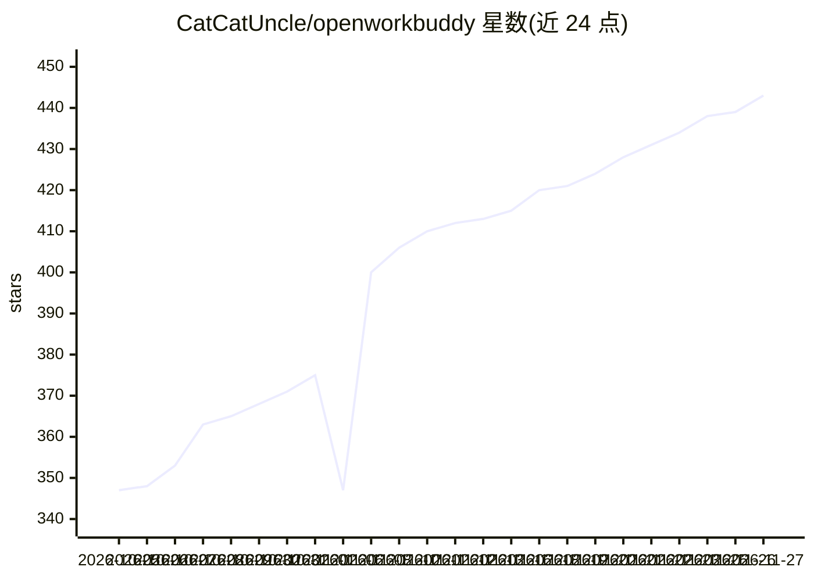

# CatCatUncle/openworkbuddy

⭐ 443 · JavaScript · NOASSERTION · 推送 2026-11-23 · [GitHub](https://github.com/CatCatUncle/openworkbuddy) · [官网](https://openworkbuddy.work) · 个人维护 · 中文 README

**本机优先的 AI 办公工作台，把需求变成可编辑办公文件**

本机优先、源码可查看的 AI 办公应用：用户输入任务与资料，应用通过 Agent 运行时规划、调用工具并验收，交付可打开编辑的 PPTX/DOCX/XLSX/HTML 文件。模型可自选（API Key 或本机 CLI 如 Claude Code/Codex），能力以 skills/<名字>/skill.md 的 Markdown 文件扩展，支持 MCP 连接器、定时任务、IM 推送、多任务并行与命令审批、权限档位等安全机制。提供 macOS/Windows 安装包、Docker 与多租户服务器部署；许可为 PolyForm Noncommercial，公司及商用须购商业授权。

## 筛选速览

| 维度 | 判定 | 备注 |
|---|---|---|
| AI 角色 | `ai-native` | 本体是模型或模型工具 |
| 许可风险 | `none` | NOASSERTION |
| 部署形态 | `desktop` | 安装包/桌面程序 |
| 模型依赖 | local-ok | 支持本地模型 |
| 硬件要求 | — | 无带数字的原话,不猜 |
| 安装摩擦 | `low` | 无编译、无系统依赖或容器化 |
| 成熟度 | — | 结构信号不足 |

## 能力要点

- 生成可打开编辑的 PPTX/DOCX/XLSX/HTML 文件，成果面板与磁盘可核对
- 模型可切换：DeepSeek/通义/智谱/Kimi/OpenRouter/Ollama，本机 Claude Code/Codex 可作引擎
- 技能即 Markdown 文件，存盘即生效；支持 MCP 连接器扩展
- 命令审批、文件黑名单、URL 白名单、审计日志与四档权限、系统沙箱

## 适用场景

- 一句话生成周报 PPT、复盘报告、Excel 表格等办公文件
- 定时抓取新闻生成晨报并推送到飞书等 IM
- 团队私有化部署，多租户管理席位与模型权限
- 做 AI 短剧、图片视频创作与旅游攻略网页

## 场景标签

`AI 助手` `工作流自动化` `AI 写作` `图像生成` · 领域:效率与自动化

## 证据(README 行号)

> L3:  本机优先、源码可查看的 AI 办公工作台，把你的资料和要求变成可打开、可修改的文件。
> L84:  一句话进去，OpenWorkBuddy 自己规划、动手、验收，出来的是 PPTX / DOCX / XLSX / HTML 文件
> L97: DeepSeek / 通义 / 智谱 / Kimi / OpenRouter / Ollama 界面点一下就切；本机装了 Claude Code / Codex 的，一键拿它当发动机，不用另买 token。配置与成果文件留在本机，

## 星数曲线

2026-10-25 347 → 2026-11-27 443（+96）

---
*卡片 v1 · prompt 1.4 · 生成 2026-11-25 · 置信度 mid · 依据 README sha `aac17facb3d7` · [字段定义](../../DATASET.md)*
