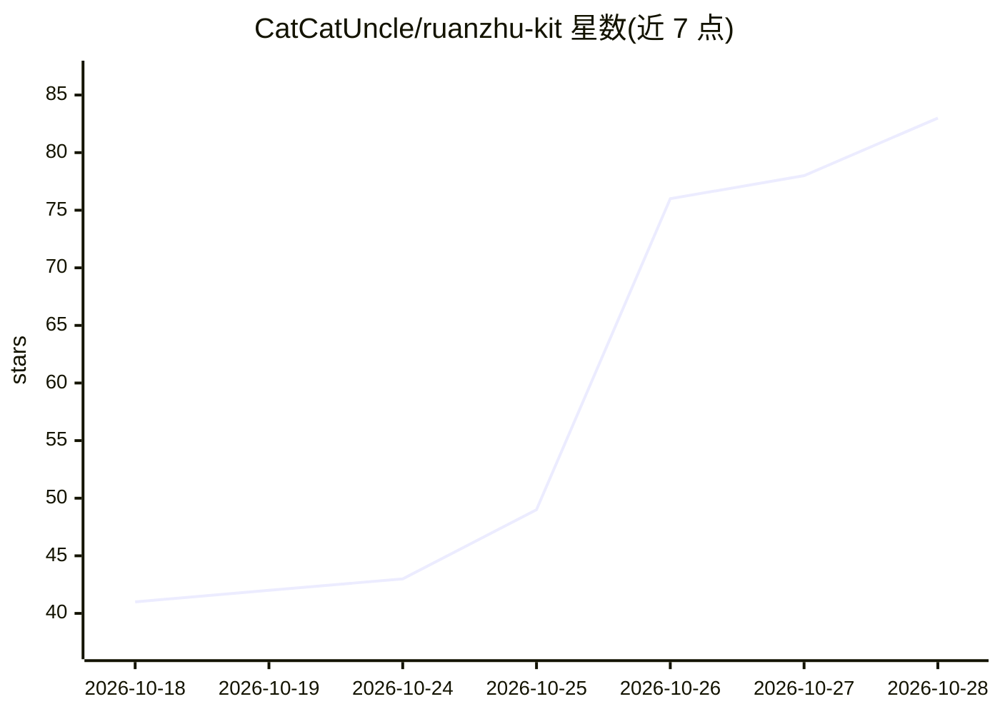

# CatCatUncle/ruanzhu-kit

⭐ 85 · JavaScript · MIT · 推送 2026-10-24 · [GitHub](https://github.com/CatCatUncle/ruanzhu-kit) · 个人维护 · 中文 README

**给中国软著申请人：从源码生成页数精确的登记材料 PDF**

面向中国软件著作权登记申请人的 Node.js 命令行工具：读取源码目录，按规定分页排版（前 30 页+后 30 页+说明页），经 Chrome 无头渲染生成程序鉴别材料 PDF 与说明书 PDF，并生成带字数校验的表单填写清单。分页在渲染前按折行行高计算，出完回读 PDF 核验页数。零 npm 依赖，需 Node 18+ 与 Chrome/Chromium/Edge。命令行不调用任何 AI 模型；附带 SKILL.md 可作为 Claude Code / Agent SDK 技能使用，另提供模板版 Skill 打包。说明书与表单描述仍需本人填写。

## 筛选速览

| 维度 | 判定 | 备注 |
|---|---|---|
| AI 角色 | `ai-enhanced` | 去掉 AI 部分产品仍成立 |
| 许可风险 | `permissive` | MIT |
| 部署形态 | `library` | 以包/库形式分发 |
| 模型依赖 | — | README 未给出锁定关系 |
| 硬件要求 | — | 无带数字的原话,不猜 |
| 安装摩擦 | `low` | 无编译、无系统依赖或容器化 |
| 成熟度 | — | 结构信号不足 |

## 能力要点

- 渲染前算死分页点，出完回读 PDF 核验页数，成品 62 页（封面+前 30+说明页+后 30）
- count 命令清点文件行数，暴露混入的依赖与构建产物
- 表单清单逐字段算字数并检查套话措辞，环境六项按本机配置预填
- 零 npm 依赖，自带 SKILL.md 可挂入 Claude Code / OpenWorkBuddy 作为 agent 技能

## 适用场景

- 我要为超过 60 页源码的项目准备软著登记材料，避免页数漂移重做
- 我想核对哪些文件被计入源程序材料、防止行数虚高被驳回
- 我把清点、分页、核页数这些机械活交给 AI agent（作为技能）执行

## 场景标签

 · 领域:软件著作权登记/文档生成工具

## 证据(README 行号)

> L48: > - 本工具的命令行**不调用任何 AI 模型**，只做机械活：清点源码、按规定分页排版、加页眉页码、数行数、核页数、算字数
> L36: > for the online form. Plain Node, zero dependencies. Works as a Claude Code / Agent SDK skill.
> L200: （Claude Code / Claude Agent SDK 都认）。clone 到技能目录即可：

## 星数曲线

2026-10-18 41 → 2026-10-28 83（+42）

---
*卡片 v1 · prompt 1.4 · 生成 2026-10-25 · 置信度 high · 依据 README sha `00ae3c923b19` · [字段定义](../../DATASET.md)*
