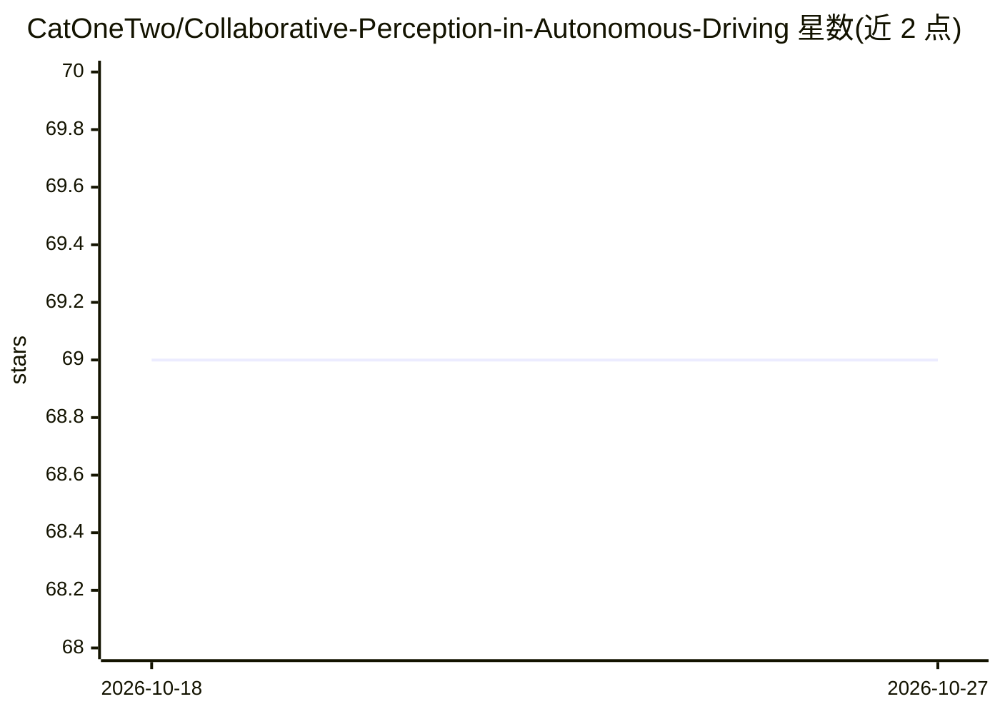

# CatOneTwo/Collaborative-Perception-in-Autonomous-Driving

⭐ 69 · 推送 2026-06-01 · [GitHub](https://github.com/CatOneTwo/Collaborative-Perception-in-Autonomous-Driving) · 组织维护 · 中文 README

**自动驾驶协同感知综述论文的论文/数据集收集清单**

配套 2023 年 IEEE ITSM 综述论文《Collaborative Perception in Autonomous Driving: Methods, Datasets and Challenges》的仓库，按论文结构分类收录协同感知相关论文、数据集与挑战方向：理想场景方法（原始数据融合、特征融合、输出融合、通信机制、损失函数）、现实问题方法（定位误差、通信问题、模型/任务差异、隐私安全），以及真实世界/仿真、V2V/V2I 数据集汇总。面向协同感知方向的研究人员，通过 issue/PR 接收新论文与代码贡献。

## 筛选速览

| 维度 | 判定 | 备注 |
|---|---|---|
| AI 角色 | `ai-knowledge` | 知识聚合/清单类 |
| 许可风险 | `none` | — |
| 部署形态 | `None` |  |
| 模型依赖 | — | README 未给出锁定关系 |
| 硬件要求 | — | 无带数字的原话,不猜 |
| 安装摩擦 | `low` | 无编译、无系统依赖或容器化 |
| 成熟度 | — | 结构信号不足 |

## 能力要点

- 按综述论文结构组织协同感知方法分类（原始数据/特征/输出融合等）
- 收录真实世界与仿真、V2V 与 V2I 数据集汇总
- 覆盖定位误差、通信、隐私安全等现实问题方法与未来挑战方向

## 适用场景

- 查找自动驾驶协同感知方向的论文与数据集
- 按理想场景/现实问题分类浏览方法脉络
- 跟踪协同感知的新趋势与开放挑战

## 场景标签

`精选清单` · 领域:学习与行业

## 证据(README 行号)

> L3: This repo is constructed for collecting and categorizing papers about collaborative perception according to our ITSM
> L28: ## Datasets

## 星数曲线

2026-10-18 69 → 2026-10-27 69（+0）

---
*卡片 v1 · prompt 1.4 · 生成 2026-10-24 · 置信度 high · 依据 README sha `29525277410a` · [字段定义](../../DATASET.md)*
