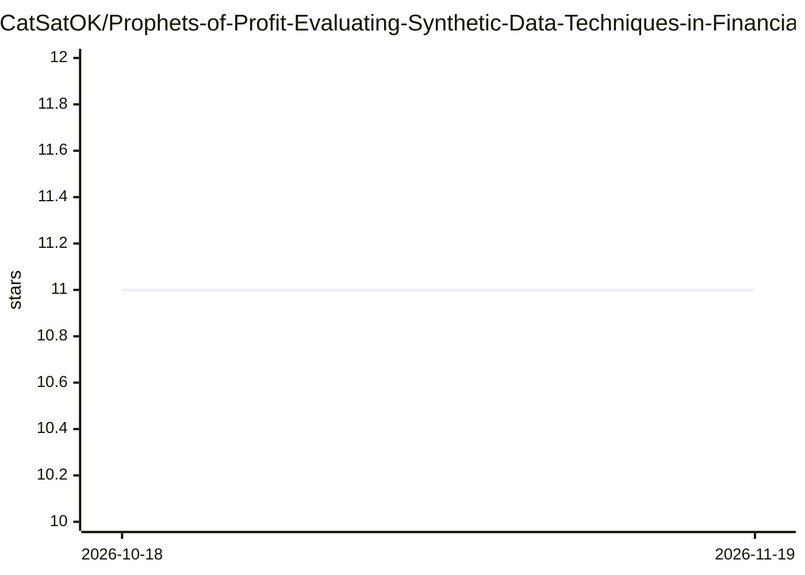

# CatSatOK/Prophets-of-Profit-Evaluating-Synthetic-Data-Techniques-in-Financial-Forecasting-Models

⭐ 11 · Jupyter Notebook · MIT · 推送 2026-07-10 · [GitHub](https://github.com/CatSatOK/Prophets-of-Profit-Evaluating-Synthetic-Data-Techniques-in-Financial-Forecasting-Models) · 个人维护

**评测四种 GAN 生成金融时序数据训练预测模型的研究项目**

一项对比研究：以 GOOG 十年日线数据为基础，用 WGAN-GP（PyTorch 从头实现）、CTGAN、TimeGAN、DoppelGANger 四种生成器产出合成时序数据，再以 LSTM（TensorFlow/Keras）在合成数据上训练、在真实价格上测 RMSE，配合 PCA/t-SNE 做分布比较。工程形态为 8 个按序执行的 Jupyter notebook 加技术指标辅助类，通过 pip 安装 requirements 后运行。2024 年完成，附 2026 视角的扩散模型等改进方案附录。

## 筛选速览

| 维度 | 判定 | 备注 |
|---|---|---|
| AI 角色 | `ai-knowledge` | 知识聚合/清单类 |
| 许可风险 | `permissive` | MIT |
| 部署形态 | `library` | 以包/库形式分发 |
| 模型依赖 | — | README 未给出锁定关系 |
| 硬件要求 | — | 无带数字的原话,不猜 |
| 安装摩擦 | `low` | 无编译、无系统依赖或容器化 |
| 成熟度 | — | 结构信号不足 |

## 能力要点

- 四种 GAN 生成器在同一预测任务下的统一 RMSE 评测
- WGAN-GP 从头实现的 PyTorch 版本
- 全流程可复现：8 个按序执行的 notebook 与 requirements.txt
- 附 2026 视角附录（扩散模型、PatchTST 等改进方案）

## 适用场景

- 复现合成金融数据对预测模型有效性的评测流程
- 为时序合成数据选型提供 RMSE 基准参考
- 学习 GAN 时序生成的 notebook 实现方式

## 场景标签

`模型评测` `金融量化` · 领域:评测与运维

## 证据(README 行号)

> L5: Can GAN-generated synthetic market data train a forecasting model that works on
> L67: ### Reproduce it

## 星数曲线

2026-10-18 11 → 2026-11-19 11（+0）

---
*卡片 v1 · prompt 1.4 · 生成 2026-11-19 · 置信度 high · 依据 README sha `c68f3ce27b15` · [字段定义](../../DATASET.md)*
