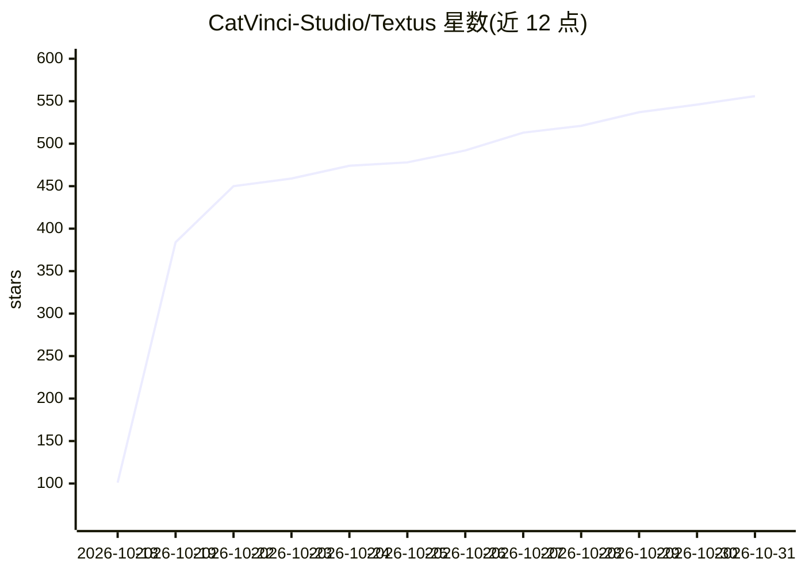

# CatVinci-Studio/Textus

⭐ 556 · TypeScript · MIT · 推送 2026-10-30 · [GitHub](https://github.com/CatVinci-Studio/Textus) · [官网](https://textus.catvinci.com) · 组织维护 · 中文 README

**带 AI 写作助手的开源 Markdown 编辑器（macOS/Windows/Linux）**

跨平台 Markdown 编辑器，采用所见即所得渲染、数学公式/表格/Mermaid 图实时显示，提供四种写作模式与 Typora 主题，可导出 PDF、Word、HTML。AI 部分为写作助手：输入停顿后给出续写、拼写与语法检查、以带理由的提案形式改写句子、翻译润色等；支持 20+ 个 LLM 及任何 OpenAI 兼容端点，也可经 Ollama 使用本地模型。文档为纯 Markdown 文件，无账户、无遥测；编辑器本身不依赖 AI 可离线完整使用。MIT 许可，CatVinci Studio 维护。

## 筛选速览

| 维度 | 判定 | 备注 |
|---|---|---|
| AI 角色 | `ai-enhanced` | 去掉 AI 部分产品仍成立 |
| 许可风险 | `permissive` | MIT |
| 部署形态 | `desktop` | 安装包/桌面程序 |
| 模型依赖 | local-ok | 支持本地模型 |
| 硬件要求 | — | 无带数字的原话,不猜 |
| 安装摩擦 | `low` | 无编译、无系统依赖或容器化 |
| 成熟度 | — | 结构信号不足 |

## 能力要点

- 续写（灰色幽灵文本 Tab 接受）与实时拼写/语法检查
- AI 编辑以带理由的提案形式逐句采纳
- 支持 20+ LLM 与任何 OpenAI 兼容 API，含 Ollama 本地模型
- 纯 Markdown 文件存储，无账户、无遥测，API key 仅存本地

## 适用场景

- 日常写作用 Markdown 编辑器，实时预览公式表格与图表
- 写作时获得续写、润色、翻译、语气调整等 AI 辅助
- 通过 Ollama 本地模型在离线/隐私要求下使用 AI 助手
- 导出 Markdown 文档为 PDF、Word、HTML

## 场景标签

`AI 写作` · 领域:内容生成

## 证据(README 行号)

> L5:  The next-generation Markdown editor.
> L131: No. The editor works fully without AI. For Textus AI, connect a provider of your own: sign in with ChatGPT or Clau

## 星数曲线

2026-10-18 101 → 2026-10-31 556（+455）

---
*卡片 v1 · prompt 1.4 · 生成 2026-10-21 · 置信度 high · 依据 README sha `b78d771fc31c` · [字段定义](../../DATASET.md)*
