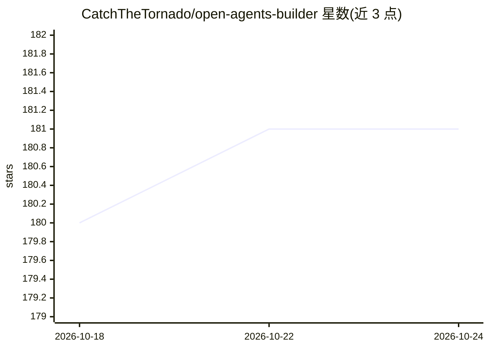

# CatchTheTornado/open-agents-builder

⭐ 181 · TypeScript · MIT · 推送 2025-12-08 · [GitHub](https://github.com/CatchTheTornado/open-agents-builder) · [官网](https://openagentsbuilder.com/) · 组织维护

**面向企业的多 Agent 可视化开发平台与后端**

Open Agents Builder 是一个用于构建业务 AI Agent 的开发平台：可视化编排多 Agent 流程（oneOf/parallel/sequence/evaluator/forEach 等组合块），以 API 形式发布流程，内置订单管理（OMS）、产品信息（PIM）、CPQ、日历预约、自定义实体等业务模块与审计日志、权限、数据加密等企业功能。面向开发者与业务用户协作场景，支持客户对话界面的 Agent 发布；引入 Eval Driven Development（AI as a Judge 自动评测）保障行为一致性。可云端试用或本地 git clone 运行，提供 npm API 客户端。

## 筛选速览

| 维度 | 判定 | 备注 |
|---|---|---|
| AI 角色 | `ai-ecosystem` | LLM/agent 周边工具 |
| 许可风险 | `permissive` | MIT |
| 部署形态 | `library` | 以包/库形式分发 |
| 模型依赖 | — | README 未给出锁定关系 |
| 硬件要求 | — | 无带数字的原话,不猜 |
| 安装摩擦 | `low` | 无编译、无系统依赖或容器化 |
| 成熟度 | — | 结构信号不足 |

## 能力要点

- 可视化编排多 Agent 流程并发布为 API
- 内置 OMS/PIM/CPQ/预约/客户等业务模块
- 审计日志、权限、共享、数据加密等企业功能
- Eval Driven Development：AI 评审自动生成与执行测试用例

## 适用场景

- 搭建电商购物助手或产品配置报价（CPQ）Agent
- 做预约、排期、到访前问询等业务流程 Agent
- 通过链接向客户分发对话式问卷并回收线索与反馈
- 将 Agent 作为应用后端，通过 API 与现有系统集成

## 场景标签

`多智能体` `Agent 框架` · 领域:Agent 开发

## 证据(README 行号)

> L8: - 💾 Design effective multi-agent workflows based on composable building blocks: `oneOf`, `parallel`, `sequence`, `ev
> L9: - 🕸️ Publish the flows as API. Read more on Flows API,
> L11: - 👩🏽‍💻 Use Open Agents Builder as an **App Backend** - full API support for any type of entities managable in the b

## 星数曲线

2026-10-18 180 → 2026-10-24 181（+1）

---
*卡片 v1 · prompt 1.4 · 生成 2026-10-22 · 置信度 mid · 依据 README sha `3c263c50afb3` · [字段定义](../../DATASET.md)*
