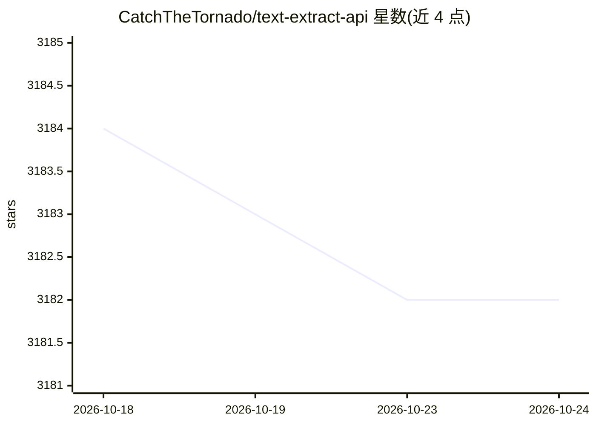

# CatchTheTornado/text-extract-api

⭐ 3,181 · Python · MIT · 推送 2025-12-08 · [GitHub](https://github.com/CatchTheTornado/text-extract-api) · [官网](https://demo.doctractor.com) · 组织维护

**文档转 Markdown/JSON 的 OCR 提取 API，支持 PII 去除**

基于 FastAPI 的文档提取 API：将图片、PDF、Office 文档转换为 Markdown 或结构化 JSON，支持表格、数字与数学公式。OCR 策略包括 EasyOCR、MiniCPM-V、LLama 3.2 Vision 及远程 marker-pdf；LLM（Ollama 模型如 Llama 3.1）用于 JSON 结构化与 OCR 结果修正。全部流程本地运行（PyTorch OCR + Ollama 经 docker-compose 部署），数据不出环境；还支持 PII 去除、Celery 异步队列、Redis 缓存与可切换存储策略。提供 CLI 工具与 API 两种使用方式。

## 筛选速览

| 维度 | 判定 | 备注 |
|---|---|---|
| AI 角色 | `ai-native` | 本体是模型或模型工具 |
| 许可风险 | `permissive` | MIT |
| 部署形态 | `self-host` | docker 或自建部署 |
| 模型依赖 | local-ok | 支持本地模型 |
| 硬件要求 | — | 无带数字的原话,不猜 |
| 安装摩擦 | `low` | 无编译、无系统依赖或容器化 |
| 成熟度 | — | 结构信号不足 |

## 能力要点

- 多 OCR 策略：EasyOCR / MiniCPM-V / Llama 3.2 Vision / 远程 marker-pdf
- Ollama 模型做 JSON 结构化与 OCR 结果文本修正
- 无云端依赖，docker-compose 一键部署，数据不外发
- PII 去除、Celery 分布式队列、Redis OCR 结果缓存

## 适用场景

- 把发票、报告等 PDF/Office 文档批量转成 Markdown 或 JSON
- 文档数字化前去除个人身份信息（PII）
- 本地化部署的文档提取服务，数据不出内网

## 场景标签

`文档解析` · 领域:知识与检索

## 证据(README 行号)

> L10: - **No Cloud/external dependencies** all you need: PyTorch based OCR (EasyOCR) + Ollama are shipped and configured 
> L11: - **PDF/Office to Markdown** conversion with very high accuracy using different OCR strategies including llama3.2-v
> L12: - **PDF/Office to JSON** conversion using Ollama supported models (eg. LLama 3.1)

## 星数曲线

2026-10-18 3,184 → 2026-10-24 3,182（-2）

---
*卡片 v1 · prompt 1.4 · 生成 2026-10-20 · 置信度 mid · 依据 README sha `7653f7fff8cc` · [字段定义](../../DATASET.md)*
