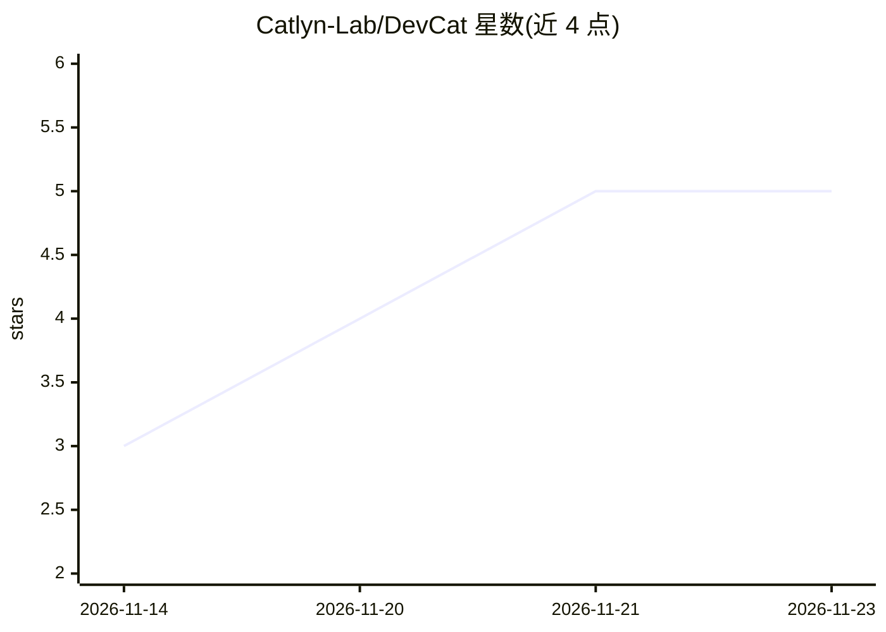

# Catlyn-Lab/DevCat

⭐ 5 · Rust · 推送 2026-11-21 · [GitHub](https://github.com/Catlyn-Lab/DevCat) · [官网](https://devcat.ai.id) · 组织维护

**开发者的 AI 编码 agent 一体化工作台：终端、Git、数据库、K8s 同窗管理**

基于 Tauri 2 + React 的跨平台桌面应用（macOS/Windows/Linux），在真实终端中运行用户已安装的编码 agent（Claude Code、Codex、Gemini CLI 等），也内置自研 DevCat Agent（带工具、审批、hooks、MCP、沙箱），可接任意 OpenAI/Anthropic 兼容模型 API。围绕 agent 集成 Git 提交图与 diff 审查、SQL/NoSQL 数据库、Kubernetes、Docker、RabbitMQ、VPN/SSH 隧道，按项目分组；提供共享记忆、端到端加密的 P2P 协作 Rooms、手机端远程控制与 Telegram/Discord 机器人审批。无账号、无服务器。

## 筛选速览

| 维度 | 判定 | 备注 |
|---|---|---|
| AI 角色 | `ai-ecosystem` | LLM/agent 周边工具 |
| 许可风险 | `none` | — |
| 部署形态 | `desktop` | 安装包/桌面程序 |
| 模型依赖 | — | README 未给出锁定关系 |
| 硬件要求 | — | 无带数字的原话,不猜 |
| 安装摩擦 | `low` | 无编译、无系统依赖或容器化 |
| 成熟度 | — | 结构信号不足 |

## 能力要点

- 在真实终端运行多种已装编码 agent，内置带 MCP 与沙箱的 DevCat Agent
- DevCat MCP server 将数据库/K8s/Docker/RabbitMQ/VPN 能力接入 Claude Code、Codex、Cursor、Gemini CLI
- agent 共享记忆跨设备同步；Telegram/Discord/手机端远程审批与控制
- 集成 Git 提交图、SQL 编辑器、Kubernetes、RabbitMQ 与 OpenVPN/WireGuard/SSH 隧道管理

## 适用场景

- 在同一个窗口里用 AI agent 写代码并同时查看 diff、提交图并操作数据库
- 通过手机或 Telegram/Discord 远程批准 agent 的操作请求
- 把数据库、K8s、隧道等连接以 MCP 形式挂给已有编码 agent
- 多人在端到端加密的 Rooms 里协作开发并共享各自的 agent

## 场景标签

`编码 Agent` · 领域:编码与开发

## 证据(README 行号)

> L19: DevCat is a free, cross-platform workbench for coding with AI agents. Run the agent you already use (Claude Code,
> L31: |AI|AI Workspace (terminal, diff, code review) running your installed coding agent: Claude Code (default), Cursor, 
> L34: |MCP|Sync MCP: DevCat's MCP server in Claude Code, Codex, Cursor and Gemini CLI: databases, Kubernetes, Docker, Rab

## 星数曲线

2026-11-14 3 → 2026-11-23 5（+2）

---
*卡片 v1 · prompt 1.4 · 生成 2026-11-21 · 置信度 mid · 依据 README sha `00abb2e47561` · [字段定义](../../DATASET.md)*
