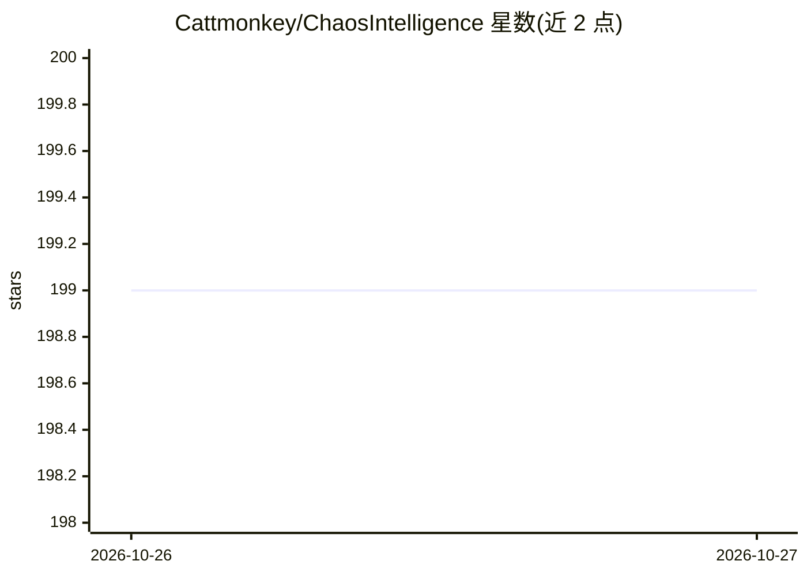

# Cattmonkey/ChaosIntelligence

⭐ 199 · Python · NOASSERTION · 推送 2026-10-24 · [GitHub](https://github.com/Cattmonkey/ChaosIntelligence) · 个人维护 · 中文 README

**把智能体作为可调用值的函数式编程语言，附 CLI 与网页 IDE**

Chaos 是一门以函数为基础、将智能体作为可调用值纳入程序的编程语言，提供 CLI、网页 IDE、目标驱动的 Bot 与生成式 UI（页面、报告、实时运行网络）。计算与流程写成函数，理解与生成交给智能体，在同一程序内传递数据协作执行；支持函数工具、电脑/手机/机器人能力、CPU/CUDA/Apple MPS 的 GPU 计算，以及 Python SDK 与 HTTP API 嵌入。使用包需 Python 3.9+，纯计算无需模型密钥，调用智能体需自行配置模型并可能产生供应商费用；采用 Chaos No-AI-Training License 1.0（源码可见，禁止用于 AI 训练，非 OSI 开源许可）。

## 筛选速览

| 维度 | 判定 | 备注 |
|---|---|---|
| AI 角色 | `ai-ecosystem` | LLM/agent 周边工具 |
| 许可风险 | `none` | NOASSERTION |
| 部署形态 | `None` |  |
| 模型依赖 | — | README 未给出锁定关系 |
| 硬件要求 | — | 无带数字的原话,不猜 |
| 安装摩擦 | `low` | 无编译、无系统依赖或容器化 |
| 成熟度 | — | 结构信号不足 |

## 能力要点

- 智能体作为一等可调用值，与函数在同一程序中组合
- CLI + 网页 IDE，页面/报告是程序返回值（RuntimeGraph 读取实际运行记录）
- 函数工具、设备能力与 CPU/CUDA/Apple MPS GPU 计算
- Python SDK 与 HTTP 接口将语言嵌入已有工程

## 适用场景

- 把规划、执行与复核组合成智能体工作流程序
- 构建围绕目标持续工作、可在接收点追加指导的 Bot
- 生成可交互的页面、报告与实时运行网络
- 在已有工程中嵌入这门语言与其服务事件

## 场景标签

`多智能体` `Agent 框架` · 领域:Agent 开发

## 证据(README 行号)

> L15: **Chaos 是一门以函数为基础、把智能体作为可调用值的编程语言。** 计算与流程写成函数，理解与生成交给智能体；让它们在同一个程序里传递数据、协作执行、返回结果。
> L100: agent teacher {

## 星数曲线

2026-10-26 199 → 2026-10-27 199（+0）

---
*卡片 v1 · prompt 1.4 · 生成 2026-10-27 · 置信度 high · 依据 README sha `58eb68cbb648` · [字段定义](../../DATASET.md)*
