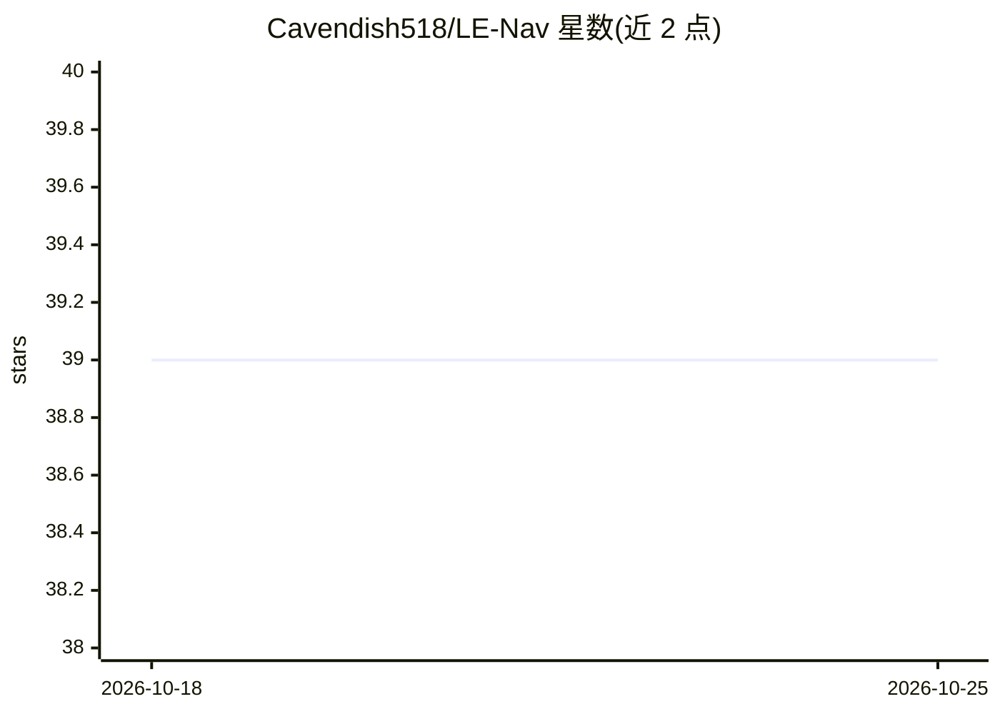

# Cavendish518/LE-Nav

⭐ 39 · Python · MIT · 推送 2026-04-20 · [GitHub](https://github.com/Cavendish518/LE-Nav) · 个人维护

**服务机器人导航框架：用 MLLM+CVAE 自动调优规划器超参数**

面向动态人机共存环境的服务机器人导航框架 LE-Nav，结合多模态大语言模型（MLLM）与条件变分自编码机（CVAE），实现零样本场景理解与专家级参数调优，可为 DWA、TEB 等任意基于优化的局部规划器自动调整超参数（各选定 8 个关键参数）。训练阶段用自有数据训练 CVAE，部署阶段在 ROS Melodic 环境下运行推理节点，并提供预训练模型参数。代码来自 IEEE T-ASE 论文的官方项目仓库。

## 筛选速览

| 维度 | 判定 | 备注 |
|---|---|---|
| AI 角色 | `ai-native` | 本体是模型或模型工具 |
| 许可风险 | `permissive` | MIT |
| 部署形态 | `library` | 以包/库形式分发 |
| 模型依赖 | — | README 未给出锁定关系 |
| 硬件要求 | — | 无带数字的原话,不猜 |
| 安装摩擦 | `medium` | 含编译或系统依赖之一 |
| 成熟度 | — | 结构信号不足 |

## 能力要点

- MLLM 零样本场景理解 + CVAE 专家级参数调优
- 适用于 DWA/TEB 等任意基于优化的规划器
- 为 TEB 与 DWA 各选定 8 个关键超参数进行学习调整
- 提供预训练模型参数与 ROS 部署流程

## 适用场景

- 为服务机器人的 DWA/TEB 规划器自动调参
- 在动态人机共存环境中部署自适应导航
- 复现论文实验或训练自己的规划器参数适配模型

## 场景标签

`多模态` · 领域:感知与多模态

## 证据(README 行号)

> L8: [\[**LE-Nav**\]](https://ieeexplore.ieee.org/document/11430584) is an interpretable and adaptive navigation framewor
> L44: Fill in the path, api key in the ROS file. (Developed with ROS Melodic.)

## 星数曲线

2026-10-18 39 → 2026-10-25 39（+0）

---
*卡片 v1 · prompt 1.4 · 生成 2026-10-25 · 置信度 high · 依据 README sha `9d6215524464` · [字段定义](../../DATASET.md)*
