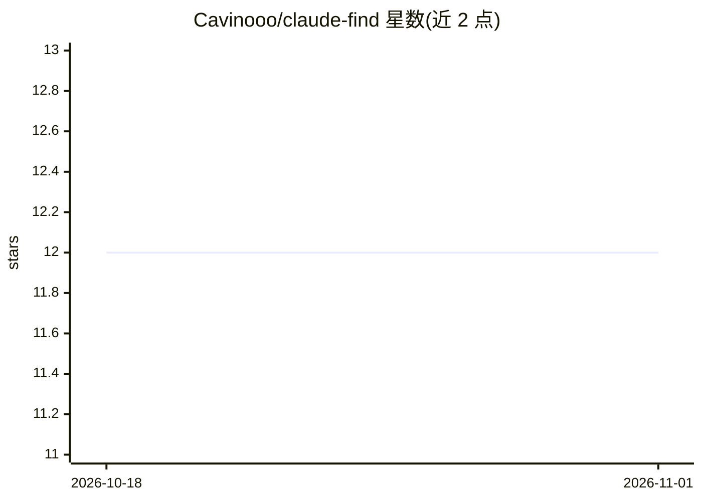

# Cavinooo/claude-find

⭐ 12 · TypeScript · MIT · 推送 2026-06-10 · [GitHub](https://github.com/Cavinooo/claude-find) · [官网](https://www.npmjs.com/package/claude-find) · 个人维护

**对历史 Claude Code 会话做语义检索的 MCP 记忆工具**

以 MCP server 形式接入 Claude Code，对 ~/.claude/projects/ 下的全部会话 JSONL 文件建立索引：抽取用户/助手消息、压缩摘要与工具调用中的文件路径，用元数据（项目、分支、文件、日期）丰富分块，再经 Ollama 的 qwen3-embedding 向量化。检索采用语义+关键词（FTS5）混合、Reciprocal Rank Fusion 合并，返回原始对话分块供 Claude 合成上下文。安装需 Bun、Ollama 与 Claude Code，setup 会关闭会话 30 天清理以保留历史。

## 筛选速览

| 维度 | 判定 | 备注 |
|---|---|---|
| AI 角色 | `ai-ecosystem` | LLM/agent 周边工具 |
| 许可风险 | `permissive` | MIT |
| 部署形态 | `None` |  |
| 模型依赖 | local-ok | 支持本地模型 |
| 硬件要求 | — | 无带数字的原话,不猜 |
| 安装摩擦 | `low` | 无编译、无系统依赖或容器化 |
| 成熟度 | — | 结构信号不足 |

## 能力要点

- 检索原始会话转录而非压缩摘要，保留推理与失败尝试
- 语义+FTS5 关键词混合检索，RRF 融合排序
- qwen3-embedding 经 Ollama 嵌入（支持 GPU 加速）
- setup 自动注册 MCP server 并在后台索引，检索即时可用

## 适用场景

- 跨项目找回过去讨论过的技术决策与约束
- 定位曾经失败过的方案避免重蹈覆辙
- 让 Claude 在当前会话中利用完整历史上下文

## 场景标签

`语义搜索` `Agent 记忆` · 领域:Agent 开发

## 证据(README 行号)

> L7: Semantic search over all your past Claude Code sessions. Finds context by meaning and keywords. Searches the raw con
> L37: 1. **Indexes** all Claude Code session JSONL files from `~/.claude/projects/`
> L41: 5. **Searches** with hybrid semantic + keyword (FTS5) merged via Reciprocal Rank Fusion

## 星数曲线

2026-10-18 12 → 2026-11-01 12（+0）

---
*卡片 v1 · prompt 1.4 · 生成 2026-11-01 · 置信度 high · 依据 README sha `8d022258f952` · [字段定义](../../DATASET.md)*
