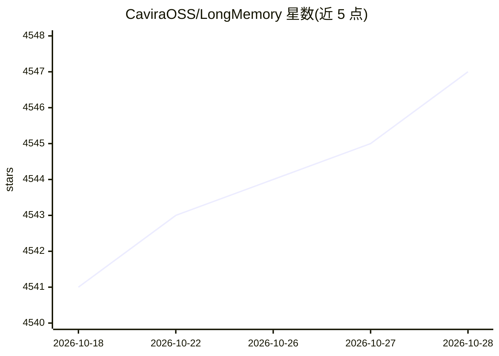

# CaviraOSS/LongMemory

⭐ 4,548 · TypeScript · Apache-2.0 · 推送 2026-10-18 · [GitHub](https://github.com/CaviraOSS/LongMemory) · [官网](https://cavira.app/projects/longmemory) · 组织维护

**面向 LLM 应用与 agent 的本地持久记忆引擎（存储/检索）**

为 LLM 应用与自主 agent 提供的认知记忆引擎：以 SQLite 做本地优先持久存储，记录不可变内容、来源与时间线，支持严格/历史/联想/世界接地四种召回模式，并通过治理域（项目/租户/用户/角色）与 token 预算控制上下文。同一 TypeScript 引擎覆盖 npm 库、CLI、HTTP 服务、MCP、Next.js 仪表盘与 VS Code 扩展；Python 侧提供零依赖 HTTP SDK（PyPI 包名为 longmemory-sdk）。嵌入支持 OpenAI 兼容 API、Gemini、Bedrock、Ollama 等多种来源，并可与 Claude Code、Codex、Dify、LangChain 等框架集成。

## 筛选速览

| 维度 | 判定 | 备注 |
|---|---|---|
| AI 角色 | `ai-ecosystem` | LLM/agent 周边工具 |
| 许可风险 | `permissive` | Apache-2.0 |
| 部署形态 | `self-host` | docker 或自建部署 |
| 模型依赖 | — | README 未给出锁定关系 |
| 硬件要求 | — | 无带数字的原话,不猜 |
| 安装摩擦 | `low` | 无编译、无系统依赖或容器化 |
| 成熟度 | — | 结构信号不足 |

## 能力要点

- SQLite 本地持久化与不可变内容/来源/时间线记录
- 四种召回模式（严格/历史/联想/世界接地）与可解释证据选择
- 单一 TypeScript 引擎覆盖 npm/CLI/HTTP/MCP/仪表盘/VS Code 扩展
- 会话迁移工具支持 Claude Code、Codex、Gemini CLI 等 coding-agent 存储

## 适用场景

- 给 coding agent 补充跨会话的项目记忆与决策历史
- 为 LLM 应用搭建自托管的长期记忆与检索服务
- 通过 MCP 将记忆工具接入 Claude Code、Dify、LangChain 等宿主
- 审计与迁移已有 agent 会话数据为治理的 Chat Memory

## 场景标签

`Agent 记忆` · 领域:Agent 开发

## 证据(README 行号)

> L13: LongMemory is a cognitive memory engine for LLM applications and autonomous agents.
> L166: - **Embeddings** through OpenAI-compatible APIs, Gemini, AWS Bedrock, Ollama, Siray, and local HTTP models.

## 星数曲线

2026-10-18 4,541 → 2026-10-28 4,547（+6）

---
*卡片 v1 · prompt 1.4 · 生成 2026-10-20 · 置信度 high · 依据 README sha `f89704062ec1` · [字段定义](../../DATASET.md)*
