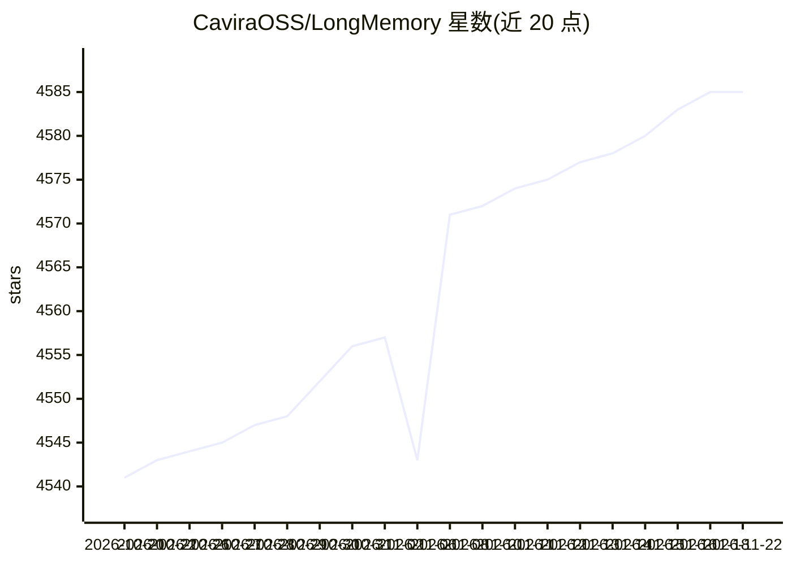

# CaviraOSS/LongMemory

⭐ 4,585 · TypeScript · Apache-2.0 · 推送 2026-11-10 · [GitHub](https://github.com/CaviraOSS/LongMemory) · [官网](https://cavira.app/projects/longmemory) · 组织维护

**面向 LLM 应用与 Agent 的本地持久记忆引擎**

以 TypeScript 实现的 LLM 应用记忆引擎，提供基于 SQLite 的本地持久存储、时间真值建模、不可变内容与溯源、多种召回模式（严格/历史/联想/依据/多语言）以及按项目/租户/角色治理的记忆范围。以 npm 库、CLI、自托管 HTTP 服务、MCP 服务器、Next.js 仪表盘与 VS Code 扩展等多种形态分发，并通过 Python SDK 供自托管服务调用。内置迁移工具导入既有 SQLite/JSON 记忆及编码 Agent 会话。

## 筛选速览

| 维度 | 判定 | 备注 |
|---|---|---|
| AI 角色 | `ai-ecosystem` | LLM/agent 周边工具 |
| 许可风险 | `permissive` | Apache-2.0 |
| 部署形态 | `self-host` | docker 或自建部署 |
| 模型依赖 | local-ok | 支持本地模型 |
| 硬件要求 | — | 无带数字的原话,不猜 |
| 安装摩擦 | `low` | 无编译、无系统依赖或容器化 |
| 成熟度 | — | 结构信号不足 |

## 能力要点

- SQLite 本地持久存储，无需外部数据库即可运行
- 五种召回模式与时间真值/证据准入控制
- npm/CLI/HTTP/MCP/仪表盘/VS Code 多形态同一引擎
- 13 个 MCP 工具及多框架集成配置包

## 适用场景

- 给编码助手（Claude Code、Codex 等）接入持久项目记忆
- 自托管记忆服务供多个 Agent 共享并按租户/角色隔离
- 导入既有编码 Agent 会话作为可治理的对话记忆

## 场景标签

`Agent 记忆` · 领域:Agent 开发

## 证据(README 行号)

> L13: LongMemory is a cognitive memory engine for LLM applications and autonomous agents.
> L167: - **Operational surfaces** through HTTP, MCP, dashboard, VS Code, n8n, and framework-native MCP clients.
> L170: ## 6. MCP and Agent Integrations

## 星数曲线

2026-10-20 4,541 → 2026-11-22 4,585（+44）

---
*卡片 v1 · prompt 1.4 · 生成 2026-11-22 · 置信度 high · 依据 README sha `06499d30116c` · [字段定义](../../DATASET.md)*
