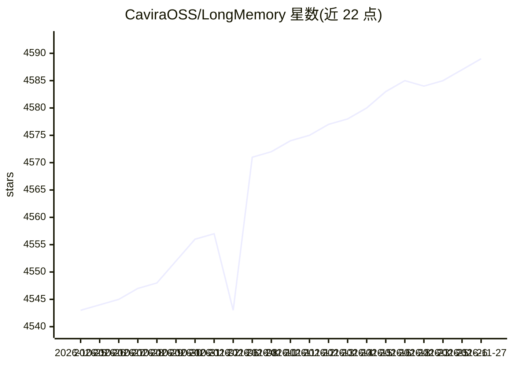

# CaviraOSS/LongMemory

⭐ 4,589 · TypeScript · Apache-2.0 · 推送 2026-11-26 · [GitHub](https://github.com/CaviraOSS/LongMemory) · [官网](https://cavira.app/projects/longmemory) · 组织维护

**为 LLM 应用与 AI agent 提供本地持久化记忆存储引擎**

LongMemory 是面向 LLM 应用和自主 agent 的认知记忆引擎：模型保持无状态，由本产品提供持久记忆层。基于 SQLite 本地优先存储，记录不可变内容、来源与时间真值；提供严格、历史、联想、接地、多语言五种召回模式，带权限治理与衰减生命周期。以 npm 库、CLI、自托管 HTTP 服务、MCP 服务器、dashboard 与 VS Code 扩展多种形态运行，并通过 MCP 接入 Claude Code、Codex、Cursor、Copilot 等 agent 宿主。

## 筛选速览

| 维度 | 判定 | 备注 |
|---|---|---|
| AI 角色 | `ai-ecosystem` | LLM/agent 周边工具 |
| 许可风险 | `permissive` | Apache-2.0 |
| 部署形态 | `self-host` | docker 或自建部署 |
| 模型依赖 | local-ok | 支持本地模型 |
| 硬件要求 | — | 无带数字的原话,不猜 |
| 安装摩擦 | `low` | 无编译、无系统依赖或容器化 |
| 成熟度 | — | 结构信号不足 |

## 能力要点

- SQLite 本地优先持久存储，库模式下无需外部数据库
- 时间性真值、不可变内容与来源追溯
- 五种召回模式（严格/历史/联想/接地/多语言）与 token 预算约束
- 通过 MCP 接入 Claude Code、Codex、Cursor、Copilot、Dify 等宿主

## 适用场景

- 让 AI 编码助手跨会话记住项目决策、架构与历史故障
- 团队共享持久记忆空间，避免向每个新会话重复交代背景
- 为 agent 工作流接入带来源与权限治理的记忆召回

## 场景标签

`Agent 记忆` · 领域:Agent 开发

## 证据(README 行号)

> L15: LongMemory is a cognitive memory engine for LLM applications and autonomous agents.
> L22: - One TypeScript engine across npm, CLI, HTTP, MCP, dashboard, and VS Code
> L174: LongMemory connects to your entire AI stack through **Model Context Protocol (MCP)**, the open standard for agent-

## 星数曲线

2026-10-25 4,543 → 2026-11-27 4,589（+46）

---
*卡片 v1 · prompt 1.4 · 生成 2026-11-27 · 置信度 high · 依据 README sha `24d2c1bedb00` · [字段定义](../../DATASET.md)*
