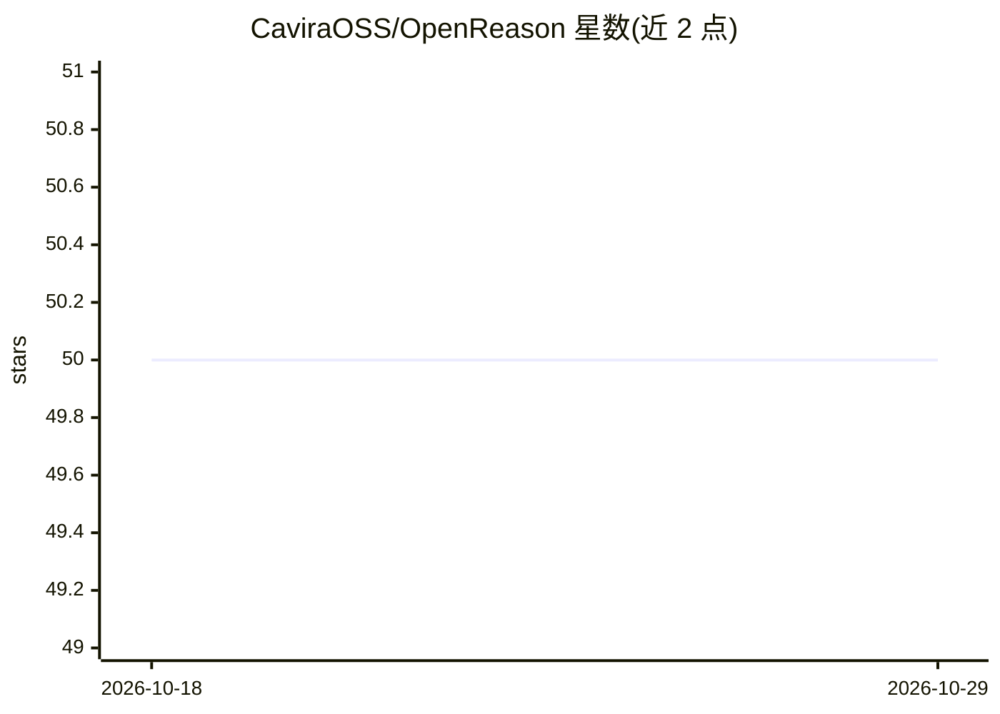

# CaviraOSS/OpenReason

⭐ 50 · TypeScript · Apache-2.0 · 推送 2025-11-15 · [GitHub](https://github.com/CaviraOSS/OpenReason) · 组织维护

**构建在任意 LLM 提供商之上的可复现推理引擎**

Node.js/TypeScript 推理引擎库：把用户查询送入固定的分类→骨架→求解→验证→定稿流水线，输出结论、置信度、模式与元数据。支持 OpenAI、Gemini、Claude、xAI、DeepSeek 等提供商，可混用不同模型控制成本；内置三种推理模式（reflex/analytic/reflective）、逐阶段提示改写、数学/逻辑/结构验证与 critic 模型调用、可选 Keyv SQLite 本地记忆。提供 SDK 与 CLI（含 mock 离线模式），可选 LangGraph StateGraph 运行同一流水线并支持检查点。需 Node 18+。

## 筛选速览

| 维度 | 判定 | 备注 |
|---|---|---|
| AI 角色 | `ai-ecosystem` | LLM/agent 周边工具 |
| 许可风险 | `permissive` | Apache-2.0 |
| 部署形态 | `library` | 以包/库形式分发 |
| 模型依赖 | locked-api |  |
| 硬件要求 | — | 无带数字的原话,不猜 |
| 安装摩擦 | `low` | 无编译、无系统依赖或容器化 |
| 成熟度 | — | 结构信号不足 |

## 能力要点

- 固定的 classify→skeleton→solve→verify→finalize 五段推理流水线，输出结论与置信度
- 提供商无关：一次 init() 切换 OpenAI/Gemini/Claude/xAI/DeepSeek，可混用简单/复杂模型
- 数学/逻辑/结构验证层加 critic 模型调用，可修复并重跑缺失步骤
- 可选 LangGraph 模式运行同一流水线，支持检查点与按线程恢复

## 适用场景

- 在我的应用或 agent 中加入带验证步骤的结构化推理
- 处理数学证明、逻辑链条、伦理与哲学类问题并查看每步中间结果
- 通过混用不同档位模型控制推理成本

## 场景标签

`Agent 框架` · 领域:Agent 开发

## 证据(README 行号)

> L6: OpenReason is a reasoning engine that sits on top of any LLM provider.
> L38: You can drop this inside any app, agent, API server, CLI script, or backend worker.

## 星数曲线

2026-10-18 50 → 2026-10-29 50（+0）

---
*卡片 v1 · prompt 1.4 · 生成 2026-10-24 · 置信度 high · 依据 README sha `9fec1bdbbdf4` · [字段定义](../../DATASET.md)*
