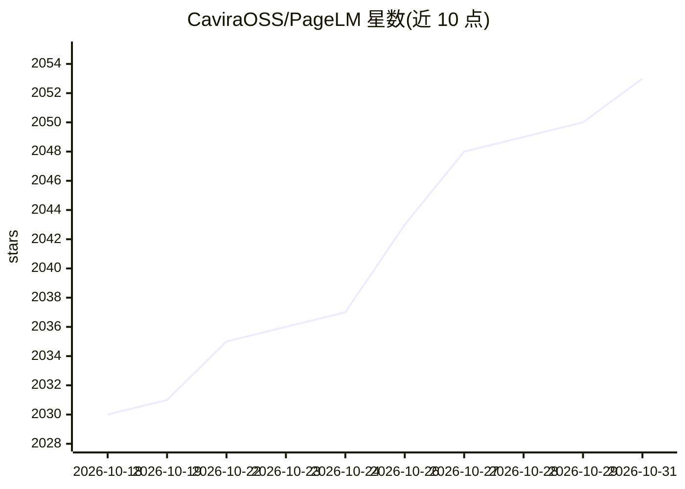

# CaviraOSS/PageLM

⭐ 2,053 · TypeScript · NOASSERTION · 推送 2026-10-29 · [GitHub](https://github.com/CaviraOSS/PageLM) · 组织维护

**开源 AI 学习平台：把学习资料转成测验、闪卡、笔记与播客**

面向学生、教师与研究者的 Web 教育平台（受 NotebookLM 启发）：上传 PDF/DOCX/Markdown/TXT 后可进行文档问答、自动生成 Cornell 风格笔记、间隔重复闪卡、带讲解的测验，并用 TTS 将内容转为音频播客；另有语音转写、作业规划、模拟考试、AI 辩论与学习伴侣功能。后端为 Node.js/TypeScript，基于 LangChain，支持十余种 LLM 提供商（含本地 Ollama）与多种 TTS 引擎，通过环境变量配置提供商，支持 Docker Compose 部署。采用 CaviraOSS Community License，商用需书面许可。

## 筛选速览

| 维度 | 判定 | 备注 |
|---|---|---|
| AI 角色 | `ai-native` | 本体是模型或模型工具 |
| 许可风险 | `none` | NOASSERTION |
| 部署形态 | `self-host` | docker 或自建部署 |
| 模型依赖 | local-ok | 支持本地模型 |
| 硬件要求 | — | 无带数字的原话,不猜 |
| 安装摩擦 | `low` | 无编译、无系统依赖或容器化 |
| 成熟度 | — | 结构信号不足 |

## 能力要点

- 学习资料转化为测验、闪卡、笔记、播客等交互资源
- 支持 Gemini/GPT/Claude/Grok/Ollama 等多种 LLM 提供商可配置切换
- WebSocket 流式输出实时生成聊天、笔记与播客
- 语音转写将讲课录音转为可搜索的学习材料

## 适用场景

- 把课件和文献上传后生成闪卡和测验来备考
- 用 AI 播客在通勤时收听自己的学习内容
- 对着上传的文档提问并生成结构化笔记

## 场景标签

`文档问答` `语音合成` `语音识别` · 领域:内容生成

## 证据(README 行号)

> L50: PageLM converts study material into **interactive resources** including quizzes, flashcards, structured notes, and 
> L59: - **AI Podcast** – Convert notes and topics into engaging audio content for learning on the go

## 星数曲线

2026-10-18 2,030 → 2026-10-31 2,053（+23）

---
*卡片 v1 · prompt 1.4 · 生成 2026-10-21 · 置信度 high · 依据 README sha `2d48d277724e` · [字段定义](../../DATASET.md)*
