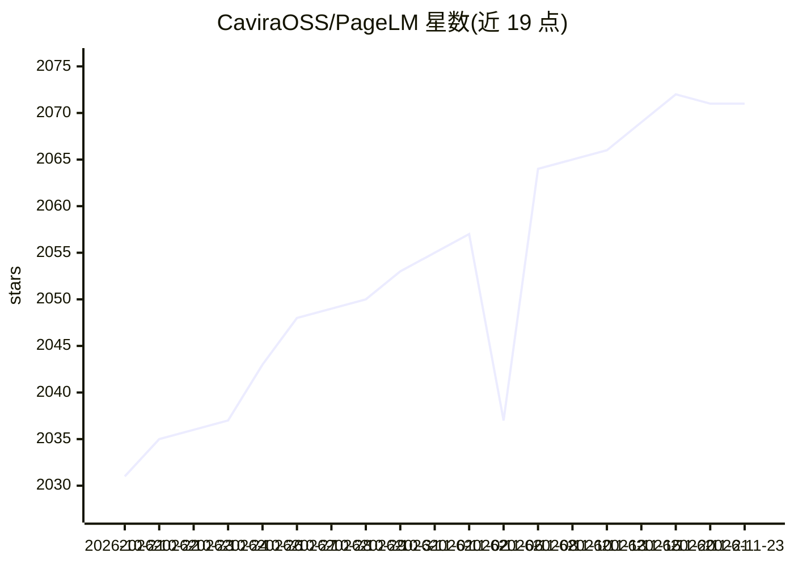

# CaviraOSS/PageLM

⭐ 2,071 · TypeScript · NOASSERTION · 推送 2026-11-15 · [GitHub](https://github.com/CaviraOSS/PageLM) · 组织维护

**开源 AI 学习平台：把学习资料转成测验、闪卡、笔记与播客**

PageLM 是一个面向学生、教师与研究人员的开源教育平台，将上传的学习资料（PDF、DOCX、Markdown、TXT）转换为互动学习资源。核心机制：通过可配置的多 LLM 提供商与 TTS 引擎生成 Cornell 式笔记、间隔重复闪卡、带提示与评分的测验、音频播客，并支持文档上下文聊天、语音转录、考试模拟与 AI 辩论。后端为 Node.js + LangChain，WebSocket 流式输出，嵌入检索支持 JSON 或向量数据库。采用 CaviraOSS Community License，个人与教育用途免费，商业使用需事先书面许可。

## 筛选速览

| 维度 | 判定 | 备注 |
|---|---|---|
| AI 角色 | `ai-native` | 本体是模型或模型工具 |
| 许可风险 | `none` | NOASSERTION |
| 部署形态 | `self-host` | docker 或自建部署 |
| 模型依赖 | local-ok | 支持本地模型 |
| 硬件要求 | — | 无带数字的原话,不猜 |
| 安装摩擦 | `low` | 无编译、无系统依赖或容器化 |
| 成熟度 | — | 结构信号不足 |

## 能力要点

- 上传文档生成测验、闪卡、Cornell 式笔记与 AI 播客
- 支持多家 LLM 提供商与本地 Ollama，多 TTS 引擎可配置
- WebSocket 流式实时生成聊天、笔记与播客
- 语音转录将讲课录音转为可检索学习材料

## 适用场景

- 把课件 PDF 一键转成复习测验和闪卡
- 把笔记转成播客在路上听
- 上传讲课录音自动整理成结构化学习资料
- 考前用 ExamLab 模拟考试并获得反馈

## 场景标签

`语音合成` `RAG` `文档问答` · 领域:内容生成

## 证据(README 行号)

> L7: **An open source AI powered education platform that transforms study materials into interactive learning experiences
> L50: PageLM converts study material into **interactive resources** including quizzes, flashcards, structured notes, and 
> L51: The platform provides a modern interface for students, educators, and researchers to **enhance learning efficiency*

## 星数曲线

2026-10-21 2,031 → 2026-11-23 2,071（+40）

---
*卡片 v1 · prompt 1.4 · 生成 2026-11-23 · 置信度 high · 依据 README sha `1364244f361b` · [字段定义](../../DATASET.md)*
