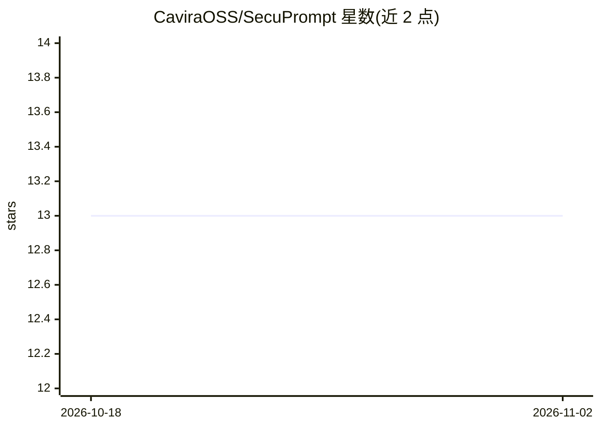

# CaviraOSS/SecuPrompt

⭐ 13 · TypeScript · NOASSERTION · 推送 2025-11-22 · [GitHub](https://github.com/CaviraOSS/SecuPrompt) · 组织维护

**LLM 提示词防火墙：在输入到达模型前拦截注入与越狱**

面向 LLM 应用的提示词安全过滤库：对用户输入进行扫描，检测角色覆盖指令（如 DAN）、提示注入、RAG 上下文投毒、Unicode 滥用（ZWJ/BiDi/同形字）等威胁，输出 allow/block/sanitize 动作，并可重构保留用户意图的安全版提示词。机制包括基于嵌入相似度的越狱语料比对与子句级模态反转检测。以 npm 与 pip 包提供，纯 TypeScript/Python 实现，无 GPU 要求，可离线运行。限制：~2ms/提示词为自述性能数字。

## 筛选速览

| 维度 | 判定 | 备注 |
|---|---|---|
| AI 角色 | `ai-ecosystem` | LLM/agent 周边工具 |
| 许可风险 | `none` | NOASSERTION |
| 部署形态 | `library` | 以包/库形式分发 |
| 模型依赖 | local-ok | 支持本地模型 |
| 硬件要求 | `cpu-ok` | |
| 安装摩擦 | `low` | 无编译、无系统依赖或容器化 |
| 成熟度 | — | 结构信号不足 |

## 能力要点

- 检测角色覆盖、提示注入、RAG 投毒、Unicode 滥用等多类威胁
- 输出 allow/block/sanitize 三态，可重构保留意图的安全提示词
- 基于越狱语料的嵌入相似度与子句级模态反转检测
- 纯 TypeScript/Python 实现，无 GPU 要求，可离线运行

## 适用场景

- 在调用 LLM 前拦截越狱与提示注入攻击
- 对 RAG 检索上下文做投毒检测与评分
- 企业敏感工具链路的可解释、确定性防护

## 场景标签

`网络安全` · 领域:学习与行业

## 证据(README 行号)

> L5: LLM-ready sanitizer that blocks jailbreaks, prompt injections, RAG poisoning, role overrides, and Unicode exploits b
> L50: if (review.action !== "allow") throw new Error("blocked or sanitize required");
> L118: - Drop-in for OpenAI, Anthropic, Google, Ollama, LlamaIndex, LangChain, Vercel AI SDK, and custom stacks.

## 星数曲线

2026-10-18 13 → 2026-11-02 13（+0）

---
*卡片 v1 · prompt 1.4 · 生成 2026-10-31 · 置信度 high · 依据 README sha `ef79afef4980` · [字段定义](../../DATASET.md)*
