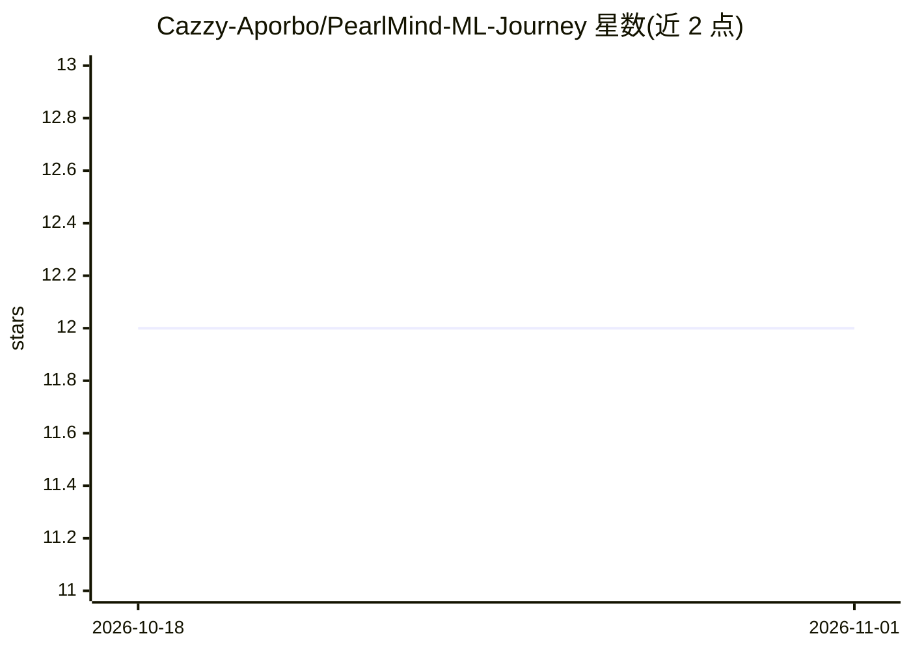

# Cazzy-Aporbo/PearlMind-ML-Journey

⭐ 12 · Python · MIT · 推送 2026-10-01 · [GitHub](https://github.com/Cazzy-Aporbo/PearlMind-ML-Journey) · [官网](https://cazzy-aporbo.github.io/PearlMind-ML-Journey/) · 个人维护

**交互式机器学习课程笔记本：在浏览器与本地运行可复现实验**

Cazandra Aporbo 维护的开源机器学习教学仓库：覆盖线性回归梯度实验、表格模型训练与评估、PyTorch CPU 实验、LSTM 与因果卷积文本实验、阈值审计和分布式梯度算术比较等课程；核心课程无需 API key、订阅或 GPU，浏览器实验在本地运行，Python 实验使用合成数据并保留结果。提供概念词典、模型统计比较脚本（Brier 分数、log loss、配对 bootstrap 区间）与模型服务命令（pearlmind serve）。README 声明这些是教学实验，不构成医疗有效性或部署就绪证明。

## 筛选速览

| 维度 | 判定 | 备注 |
|---|---|---|
| AI 角色 | `ai-knowledge` | 知识聚合/清单类 |
| 许可风险 | `permissive` | MIT |
| 部署形态 | `library` | 以包/库形式分发 |
| 模型依赖 | — | README 未给出锁定关系 |
| 硬件要求 | — | 无带数字的原话,不猜 |
| 安装摩擦 | `low` | 无编译、无系统依赖或容器化 |
| 成熟度 | — | 结构信号不足 |

## 能力要点

- 课程覆盖梯度学习、PyTorch CPU 实验、LSTM/因果卷积文本预测与分布式加权梯度比较
- 模型比较课程输出 Brier 分数、log loss 与配对 bootstrap 区间
- 训练出的表格模型可通过 pearlmind serve 提供 HTTP 预测接口
- 核心课程无需 API key、订阅或 GPU，实验结果本地保留

## 适用场景

- 通过先预测再运行代码的方式学习机器学习原理
- 在课堂上用浏览器实验教学生理解模型行为与评估陷阱
- 运行可复现的模型比较与阈值审计实验

## 场景标签

`教程课程` · 领域:学习与行业

## 证据(README 行号)

> L8: PearlMind is my open machine-learning notebook: the arithmetic, the code, the awkward results, and the decisions a s
> L10: Start with a small question. Make your prediction before running the code. Then inspect what changed. The aim is no

## 星数曲线

2026-10-18 12 → 2026-11-01 12（+0）

---
*卡片 v1 · prompt 1.4 · 生成 2026-11-01 · 置信度 high · 依据 README sha `3c53e9ecc84e` · [字段定义](../../DATASET.md)*
