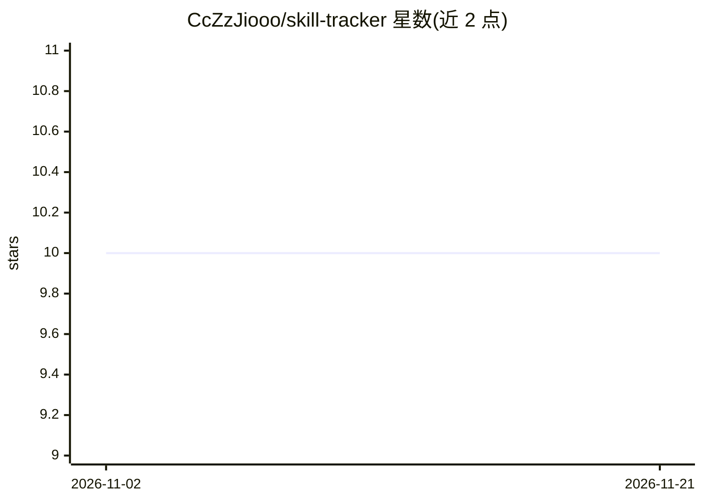

# CcZzJiooo/skill-tracker

⭐ 10 · PowerShell · MIT · 推送 2026-09-01 · [GitHub](https://github.com/CcZzJiooo/skill-tracker) · 个人维护 · 中文 README

**本地优先的 AI Agent 技能调用可视化与治理仪表盘**

扫描本机 AI 编程工具（Codex、Claude Code、Cursor、Gemini CLI、CodeBuddy 等 20 余种）的会话日志，检测 SKILL.md 调用并在静态 dashboard 中展示：调用热力图、时间线、按工具统计、中文技能描述字典、重复/相似技能治理评分、GitHub 仓库雷达与可导出的清理方案。默认全部本地运行、无服务器；由 PowerShell 采集脚本加浏览器静态页面两部分组成，通过便携 ZIP 或 git clone 运行，Linux/macOS 需 PowerShell 7。

## 筛选速览

| 维度 | 判定 | 备注 |
|---|---|---|
| AI 角色 | `ai-ecosystem` | LLM/agent 周边工具 |
| 许可风险 | `permissive` | MIT |
| 部署形态 | `desktop` | 安装包/桌面程序 |
| 模型依赖 | — | README 未给出锁定关系 |
| 硬件要求 | — | 无带数字的原话,不猜 |
| 安装摩擦 | `low` | 无编译、无系统依赖或容器化 |
| 成熟度 | — | 结构信号不足 |

## 能力要点

- 扫描 20 余种本地 AI 编程工具日志，统计 SKILL.md 调用与跨工具矩阵
- 中文技能描述字典，支持 frontmatter、手动编辑与本地自动摘要三种来源
- 治理雷达：重复技能检测、元数据缺失、健康评分与 P0/P1/P2 行动方案导出
- 本地优先：无服务器、不上传内容，支持匿名化导出

## 适用场景

- 查看各 AI 编程工具实际调用了哪些技能
- 清理重复或描述缺失的本地技能库
- 为非英语用户翻译技能用途说明
- 国内网络环境下通过 Gitee/GitCode 镜像获取源码

## 场景标签

`LLM 可观测性` · 领域:评测与运维

## 证据(README 行号)

> L10: Local-first observability for AI agent skills.
> L39: Skill Tracker 是一个本地优先的 AI Agent 技能调用可视化工具。它扫描本机 AI 编程工具的会话日志，统计哪些 `SKILL.md` 被调用，并在静态 dashboard 中展示技能热度、调用链路、中文功能说明
> L71: The first launch reads local AI-agent logs and opens the browser. Every later launch asks the current watcher to re

## 星数曲线

2026-11-02 10 → 2026-11-21 10（+0）

---
*卡片 v1 · prompt 1.4 · 生成 2026-11-20 · 置信度 high · 依据 README sha `2e73c5d225d7` · [字段定义](../../DATASET.md)*
