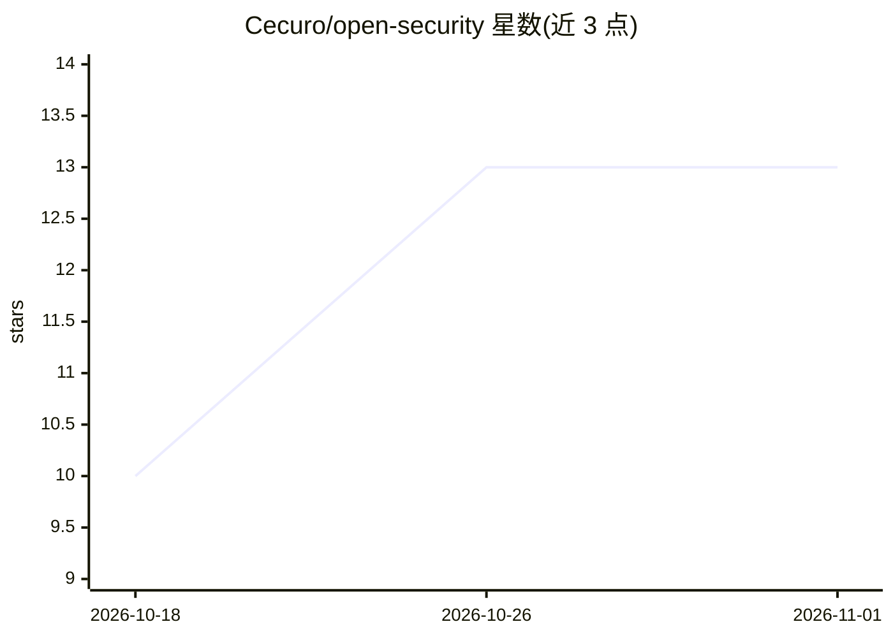

# Cecuro/open-security

⭐ 13 · TypeScript · Apache-2.0 · 推送 2026-10-26 · [GitHub](https://github.com/Cecuro/open-security) · 组织维护

**本地运行的 AI 安全审查工具：扫描代码库产出经验证的漏洞发现**

OpenSec 在本地对代码仓库运行多个安全审查 agent，各 probe 独立扫描同一范围后合并去重候选发现，再由独立 validator 沿入口点到影响的路径验证并尽量复现问题，依据可达性、所需权限、影响等记录事实给出严重度。结果存入本地 SQLite 账本，配套 CLI 与本地审查 UI，支持按严重度过滤、确认/抑制/评论发现、导出 JSON/CSV/SARIF/HTML。需 Node.js 22.19+ 与 Docker Engine 28+，处于早期开发阶段。

## 筛选速览

| 维度 | 判定 | 备注 |
|---|---|---|
| AI 角色 | `ai-native` | 本体是模型或模型工具 |
| 许可风险 | `permissive` | Apache-2.0 |
| 部署形态 | `library` | 以包/库形式分发 |
| 模型依赖 | — | README 未给出锁定关系 |
| 硬件要求 | — | 无带数字的原话,不猜 |
| 安装摩擦 | `low` | 无编译、无系统依赖或容器化 |
| 成熟度 | `idea` | |

## 能力要点

- 多 probe 独立扫描+独立验证器的发现校验流程
- SQLite 本地账本记录扫描、发现、证据与团队决策
- 本地审查 UI 支持过滤、评论、导出 SARIF 等
- 可编辑的持久化威胁模型，跨扫描复用

## 适用场景

- 对代码仓库跑本地 AI 安全扫描并复核发现
- 团队在审查 UI 中协同确认或抑制安全发现
- 通过导出 SARIF 和 CI 严重度阈值接入流程

## 场景标签

`代码审查` `网络安全` · 领域:编码与开发

## 证据(README 行号)

> L3: OpenSec runs security-review agents against a repository, validates what they find, and keeps the results in a local
> L5: OpenSec started as an internal benchmark of the OpenAI Codex Security approach using lean prompts and other models. 
> L22: Each probe gets the same full scan scope and searches it independently. One run will miss things that another finds

## 星数曲线

2026-10-18 10 → 2026-11-01 13（+3）

---
*卡片 v1 · prompt 1.4 · 生成 2026-10-31 · 置信度 high · 依据 README sha `ec550a5e2609` · [字段定义](../../DATASET.md)*
