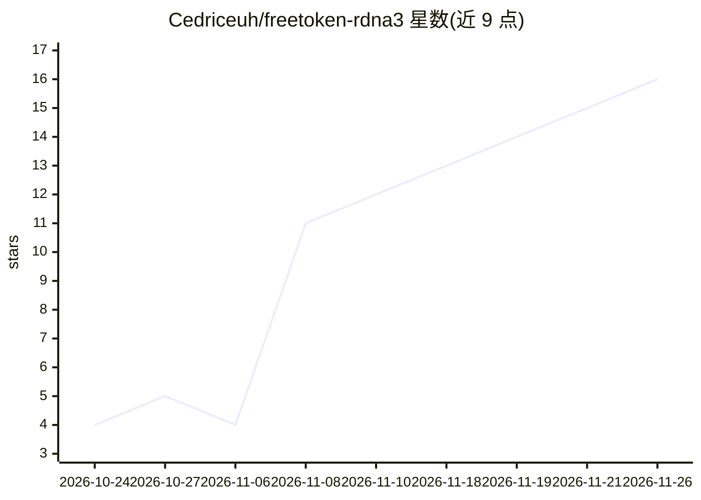

# Cedriceuh/freetoken-rdna3

⭐ 16 · Python · Apache-2.0 · 推送 2026-11-22 · [GitHub](https://github.com/Cedriceuh/freetoken-rdna3) · 个人维护

**在 AMD RDNA3 消费级显卡上本地运行 Qwen3.8-Flash-Next 的推理服务器**

FreeToken MoE 引擎针对 RDNA3（ROCm）的调优构建，让用户在一或两块 RX 7900 XTX/XT 上运行 125B 参数 MoE 模型 Qwen3.8-Flash-Next。机制：专家权重驻留系统内存，GPU 保留最常用专家；提供 OpenAI/Anthropic 兼容 API，支持最多 4 个并行请求（262k 上下文）或单会话 1M 上下文，支持 NVFP4 与 EXL3 三种检查点。限制：仅在一台参考机器上实测，其他 RDNA3/RDNA4/NVIDIA 卡未测试；需 Docker、Linux x86_64、128 GB 内存（64 GB 有降级路径）。

## 筛选速览

| 维度 | 判定 | 备注 |
|---|---|---|
| AI 角色 | `ai-ecosystem` | LLM/agent 周边工具 |
| 许可风险 | `permissive` | Apache-2.0 |
| 部署形态 | `self-host` | docker 或自建部署 |
| 模型依赖 | — | README 未给出锁定关系 |
| 硬件要求 | — | 无带数字的原话,不猜 |
| 安装摩擦 | `low` | 无编译、无系统依赖或容器化 |
| 成熟度 | — | 结构信号不足 |

## 能力要点

- 单/双 RX 7900 卡运行 125B MoE 模型，专家权重放系统内存
- OpenAI/Anthropic 兼容 API，支持 262k×4 并行或 1M 单上下文
- NVFP4 与 EXL3（3.05/4.05 bpw）三种检查点可选，含速度实测表
- rdna3/serve.sh --check 自动检测机器并推荐 profile

## 适用场景

- 在本地 AMD 显卡上给聊天应用和编码 agent 提供模型服务
- 用 OpenCode/Claude Code 等编码工具连接本地长上下文模型
- 并行运行多个 agent 子任务并处理超长文档输入

## 场景标签

`推理引擎` · 领域:训练与推理

## 证据(README 行号)

> L6: XTX / XT cards.** You get a local server with an OpenAI- and Anthropic-compatible API: chat apps, coding agents
> L10: It is a tuned build of the FreeToken MoE engine for RDNA3 (ROCm). The model
> L22: |System|Linux x86_64 with the in-kernel `amdgpu` driver, and Docker. ROCm, PyTorch and the rest come inside the ima

## 星数曲线

2026-10-24 4 → 2026-11-26 16（+12）

---
*卡片 v1 · prompt 1.4 · 生成 2026-11-18 · 置信度 high · 依据 README sha `de2177d6628c` · [字段定义](../../DATASET.md)*
