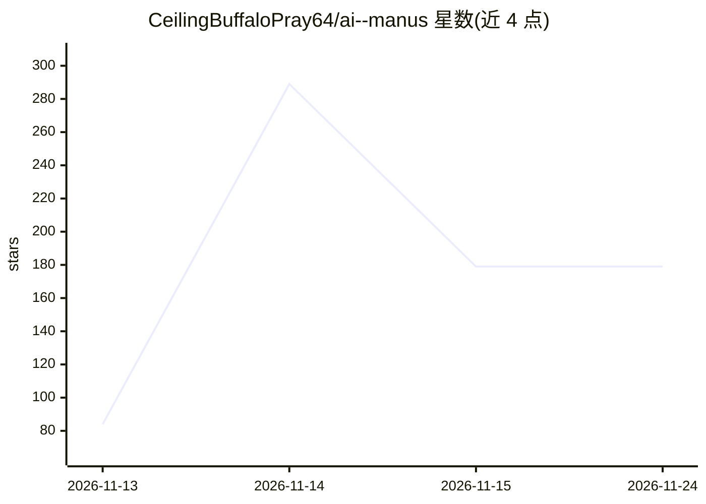

# CeilingBuffaloPray64/ai--manus

⭐ 179 · Apache-2.0 · 推送 2026-11-15 · [GitHub](https://github.com/CeilingBuffaloPray64/ai--manus) · 个人维护

**面向日常任务的自主 AI Agent：代用户执行代码与浏览器操作**

Manus 是一个自主 AI Agent，定位为家庭、学习与轻量办公场景的个人助手：接收自然语言指令后代用户编写并执行脚本、控制浏览器（导航页面、填写表单、采集信息），并可执行多步骤、跨代码与浏览器的任务。README 说明其可在会话间保持任务模式的一致性，用户无需编程背景。文档为营销式说明，给出兼容性表（最低 4GB 内存、双核 CPU）与上手流程，但未提供具体安装命令、技术栈或代码入口。

## 筛选速览

| 维度 | 判定 | 备注 |
|---|---|---|
| AI 角色 | `ai-native` | 本体是模型或模型工具 |
| 许可风险 | `permissive` | Apache-2.0 |
| 部署形态 | `None` |  |
| 模型依赖 | — | README 未给出锁定关系 |
| 硬件要求 | — | 无带数字的原话,不猜 |
| 安装摩擦 | `low` | 无编译、无系统依赖或容器化 |
| 成熟度 | — | 结构信号不足 |

## 能力要点

- 自主执行代码：代用户编写并运行脚本完成任务
- 浏览器控制：导航网页、填表单、采集信息
- 代码与浏览器操作可在同一任务流中衔接
- 面向家庭、学习与轻量办公的小规模场景

## 适用场景

- 让学生整理研究笔记、跑快速计算
- 让 Agent 代为浏览多页面收集资料并汇总
- 把重复性的小任务委托给后台助手处理

## 场景标签

`AI 助手` `浏览器自动化` · 领域:效率与自动化

## 证据(README 行号)

> L10: - **Autonomous Code Execution:** Manus AI agent runs code on its own to complete tasks, so you can focus on decisio
> L18: Manus is an autonomous AI agent designed to run code and control a browser on your behalf. Instead of acting like a

## 星数曲线

2026-11-13 84 → 2026-11-24 179（+95）

---
*卡片 v1 · prompt 1.4 · 生成 2026-11-17 · 置信度 mid · 依据 README sha `a3d88e202bf0` · [字段定义](../../DATASET.md)*
