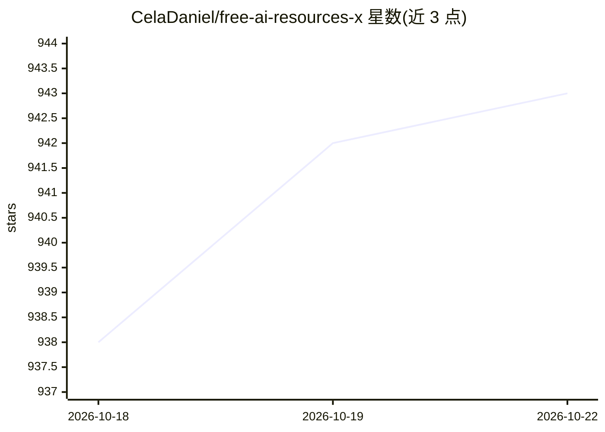

# CelaDaniel/free-ai-resources-x

⭐ 946 · MIT · 推送 2026-05-21 · [GitHub](https://github.com/CelaDaniel/free-ai-resources-x) · [官网](https://github.com/CelaDaniel/free-ai-resources-x/) · 个人维护

**面向自学者的免费 AI 学习资源清单（411+ 条，30 类）**

社区维护的 AI 学习资源策展清单：收录 411+ 条免费资源，按 30 个类别组织（Python、机器学习、深度学习、计算机视觉、生成式 AI、AI 伦理、MLOps 等），并按初级/中级/高级分层。提供按目标划分的学习路径（如转行、求职、方向专精），资源需满足免费、高质量、可访问、有教育价值四项标准方可收录。通过 PR 向 /resources/ 目录添加条目参与贡献。

## 筛选速览

| 维度 | 判定 | 备注 |
|---|---|---|
| AI 角色 | `ai-knowledge` | 知识聚合/清单类 |
| 许可风险 | `permissive` | MIT |
| 部署形态 | `None` |  |
| 模型依赖 | — | README 未给出锁定关系 |
| 硬件要求 | — | 无带数字的原话,不猜 |
| 安装摩擦 | `medium` | 含编译或系统依赖之一 |
| 成熟度 | — | 结构信号不足 |

## 能力要点

- 411+ 条免费资源，按 30 个类别组织
- 资源同时按主题与难度（Beginner/Intermediate/Advanced）分层
- 提供按身份与目标划分的学习路径表
- 明确的质量收录标准（免费/高质量/可访问/有教育价值）

## 适用场景

- 零基础按路径规划 3-6 个月的 AI 入门学习
- 已有基础者选择方向专精（NLP、CV、MLOps 等）查找资源
- 系统浏览 AI 伦理、边缘计算、AI 求职等专题资源

## 场景标签

`精选清单` · 领域:学习与行业

## 证据(README 行号)

> L16: **411+ hand picked resources** · **30 specialized categories** · **100% free** · **Community driven**
> L24: - **Structured for learning** — Resources organized by topic AND difficulty (`Beginner` → `Intermediate` → `Advance

## 星数曲线

2026-10-18 938 → 2026-10-22 943（+5）

---
*卡片 v1 · prompt 1.4 · 生成 2026-10-21 · 置信度 high · 依据 README sha `d32ba33ae0f0` · [字段定义](../../DATASET.md)*
