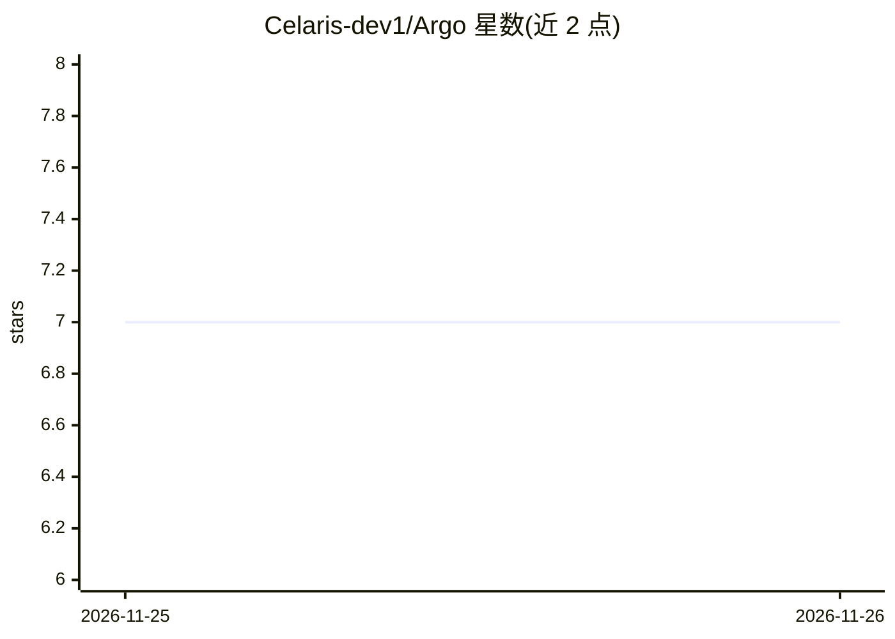

# Celaris-dev1/Argo

⭐ 7 · TypeScript · Apache-2.0 · 推送 2026-11-25 · [GitHub](https://github.com/Celaris-dev1/Argo) · [官网](https://argoai.top) · 组织维护 · 中文 README

**可自托管的持久化 AI 智能体，自带可操作的计算机环境**

开源 AI agent 平台，定位为可长期运行的 AI 队友/助手：每个 bot 拥有独立会话、记忆、例行任务与历史记录，并可执行操作并出具回执。支持浏览器、终端、文件与图形桌面访问，bot 可互相委托或派生短生命周期 subagent；操作需经每应用 Allow/Ask/Block 审批。提供 Web、Electron 桌面端与 iPhone/Android 客户端，可通过 Docker Compose 镜像安装或从源码以 pnpm 运行，模型凭据由用户自带（BYO）。项目处于 beta 阶段。

## 筛选速览

| 维度 | 判定 | 备注 |
|---|---|---|
| AI 角色 | `ai-native` | 本体是模型或模型工具 |
| 许可风险 | `permissive` | Apache-2.0 |
| 部署形态 | `desktop` | 安装包/桌面程序 |
| 模型依赖 | — | README 未给出锁定关系 |
| 硬件要求 | — | 无带数字的原话,不猜 |
| 安装摩擦 | `low` | 无编译、无系统依赖或容器化 |
| 成熟度 | `idea` | |

## 能力要点

- 持久化 bot：独立会话、记忆、例行任务与历史
- 浏览器/终端/文件/图形桌面的计算机访问与每应用审批机制
- 支持 Docker、E2B、Daytona、CreateOS、Railway 等多种计算机提供方
- Web/Electron/移动多端客户端，UI 支持 14 种语言

## 适用场景

- 在自己服务器上长期运行私人 AI 助手
- 让 bot 执行浏览器自动化与桌面操作并审批其行为
- 自带模型凭据搭建完整本地技术栈

## 场景标签

`AI 助手` `浏览器自动化` `GUI 自动化` · 领域:效率与自动化

## 证据(README 行号)

> L11: Argo is an open source AI agent for persistent teammates, and a self-hosted AI assistant you
> L40: - Browser, terminal, file, and graphical desktop access
> L89: Open http://127.0.0.1:5173, create an account, and connect a model.

## 星数曲线

2026-11-25 7 → 2026-11-26 7（+0）

---
*卡片 v1 · prompt 1.4 · 生成 2026-11-25 · 置信度 high · 依据 README sha `4e26c512d614` · [字段定义](../../DATASET.md)*
