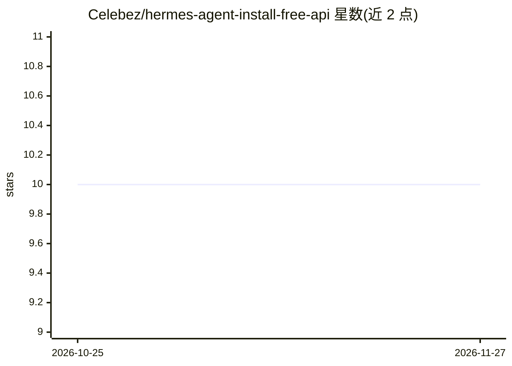

# Celebez/hermes-agent-install-free-api

⭐ 10 · Shell · 推送 2026-06-28 · [GitHub](https://github.com/Celebez/hermes-agent-install-free-api) · 个人维护

**Linux 上安装 Hermes Agent 与申请免费 API key 的教程**

面向 Linux 用户的安装教程文档，覆盖 Ubuntu/Debian、Fedora、Arch 三类发行版的分步安装命令与前置条件（Python 3.10+、2GB RAM），并整理 20 家提供免费 API key 的 provider 清单及 signup 步骤。包含 hermes setup 向导、Telegram/Discord gateway 配置、多 provider fallback、上下文压缩、本地 Whisper STT 等配置技巧，以及常见报错的 troubleshooting 方案。教程针对 Nous Research 的 hermes-agent，本身不含代码产品。

## 筛选速览

| 维度 | 判定 | 备注 |
|---|---|---|
| AI 角色 | `ai-knowledge` | 知识聚合/清单类 |
| 许可风险 | `none` | — |
| 部署形态 | `library` | 以包/库形式分发 |
| 模型依赖 | — | README 未给出锁定关系 |
| 硬件要求 | — | 无带数字的原话,不猜 |
| 安装摩擦 | `medium` | 含编译或系统依赖之一 |
| 成熟度 | — | 结构信号不足 |

## 能力要点

- Ubuntu/Debian/Fedora/Arch 三套分步安装命令（2026-06 测试记录）
- 20 家免费 API key provider 清单，标注各 free tier 额度
- 多 provider fallback 与上下文压缩等配置技巧
- 覆盖 401/404、PATH、PEP 668 等报错的 troubleshooting

## 适用场景

- 在 Linux 终端安装并配置 Hermes Agent CLI
- 为 AI agent 寻找免信用卡的免费 LLM API 渠道
- 配置 Telegram/Discord bot gateway 或本地 Whisper 语音识别

## 场景标签

`教程课程` · 领域:学习与行业

## 证据(README 行号)

> L5: Tutorial lengkap install **Hermes Agent** di Linux (Ubuntu/Debian/Fedora/Arch) lengkap dengan **tips dapetin API key
> L23: 1. Apa itu Hermes Agent?

## 星数曲线

2026-10-25 10 → 2026-11-27 10（+0）

---
*卡片 v1 · prompt 1.4 · 生成 2026-11-20 · 置信度 high · 依据 README sha `633551ceaefe` · [字段定义](../../DATASET.md)*
