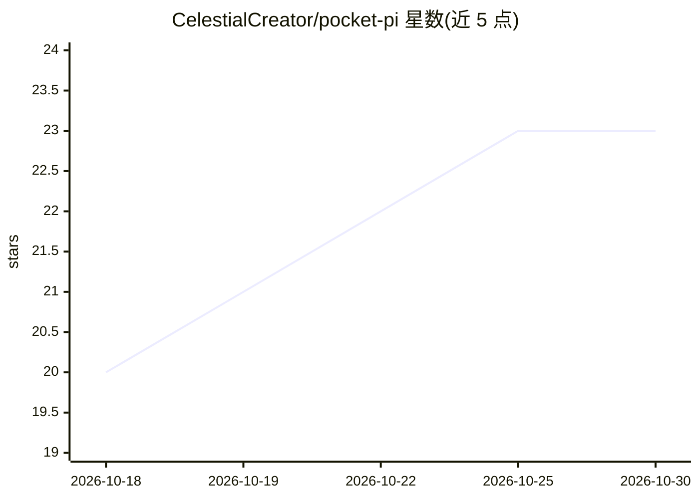

# CelestialCreator/pocket-pi

⭐ 23 · Kotlin · NOASSERTION · 推送 2026-05-14 · [GitHub](https://github.com/CelestialCreator/pocket-pi) · [官网](https://github.com/CelestialCreator/pocket-pi/releases/latest) · 个人维护

**在 Android 手机上单 APK 运行 Pi 编程代理的应用**

将 Pi coding agent 打包为 Android APK：内置 Termux 运行时（Node/Python/git）、Android 服务监督 pi --mode rpc 与 pi-agent-dashboard Web UI（WebView 渲染），首启自动 bootstrap。支持 Anthropic Claude Pro/Max OAuth 端到端登录（捆绑 pi-anthropic-messages 桥），以及 OpenAI/Gemini/Groq/OpenRouter 等多家 API key 聊天。通过本机 HTTP 桥向代理开放通知、意图、相机、麦克风、定位、剪贴板等手机能力，v0.4.0 增加 AccessibilityService 手机 UI 自动化（读屏、派发点击滑动）。限制：仅 aarch64，其他 OAuth 供应商登录后不可用，终端标签页不可用。

## 筛选速览

| 维度 | 判定 | 备注 |
|---|---|---|
| AI 角色 | `ai-native` | 本体是模型或模型工具 |
| 许可风险 | `none` | NOASSERTION |
| 部署形态 | `desktop` | 安装包/桌面程序 |
| 模型依赖 | locked-api |  |
| 硬件要求 | — | 无带数字的原话,不猜 |
| 安装摩擦 | `low` | 无编译、无系统依赖或容器化 |
| 成熟度 | `idea` | |

## 能力要点

- 单 APK 捆绑 Termux 运行时与 Pi 代理引擎，无需 root
- Claude Pro/Max OAuth 端到端可用（捆绑协议桥），另支持 OpenAI/Gemini/Groq/OpenRouter 等 API key
- 本机 HTTP 桥（127.0.0.1:9998，每次启动轮换 bearer token）向代理开放通知/相机/麦克风/定位/剪贴板等手机能力
- v0.4.0 加入 AccessibilityService 手机 UI 自动化（读屏、点击/滑动/手势派发）与内置 android-control 技能

## 适用场景

- 在 Android 手机上运行 Pi 编程代理并与各家 LLM 对话
- 让代理操作手机：发通知、调起应用、拍照录音、读取屏幕并自动点击
- 用 Claude Pro/Max 订阅额度在手机端登录使用

## 场景标签

`编码 Agent` `GUI 自动化` · 领域:效率与自动化

## 证据(README 行号)

> L3: A Pi coding agent shipped as an Android APK. No Termux install, no shell setup — install the APK, paste an LLM key (
> L10: What Pocket Pi adds is the packaging: a Termux runtime, postinstall script, an Android service that supervises `pi 

## 星数曲线

2026-10-18 20 → 2026-10-30 23（+3）

---
*卡片 v1 · prompt 1.4 · 生成 2026-10-27 · 置信度 mid · 依据 README sha `6a69926a1f86` · [字段定义](../../DATASET.md)*
