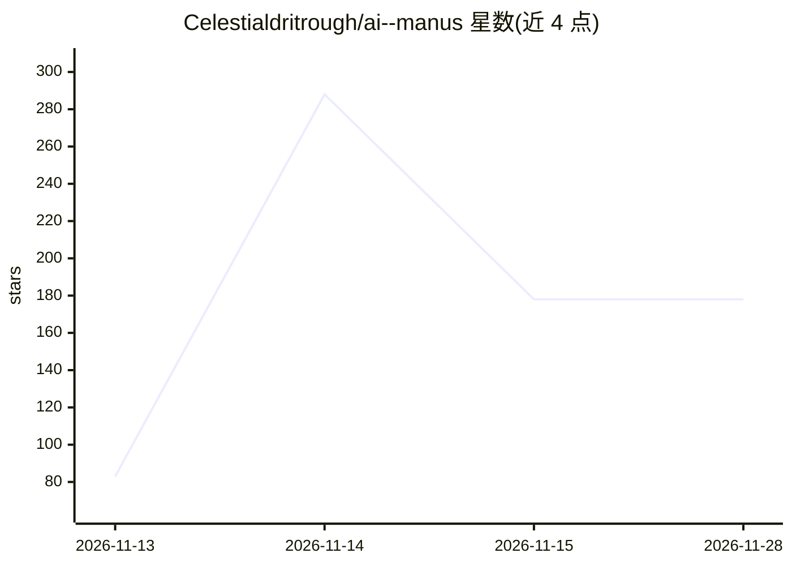

# Celestialdritrough/ai--manus

⭐ 178 · Apache-2.0 · 推送 2026-11-15 · [GitHub](https://github.com/Celestialdritrough/ai--manus) · 个人维护

**面向日常任务的自主 AI Agent：自动执行代码与浏览器操作**

README 声明 Manus 为自主 AI agent，在用户指令下自行编写并执行脚本、控制浏览器完成表单填写与信息收集等多步骤任务，可后台常驻作为个人助手，面向学习、家庭与轻量办公场景，不要求用户具备开发能力。描述中给出 CPU/内存等兼容性表格与使用步骤说明，但全文未提供代码仓库内容、安装命令或技术实现细节；主题标签提及 OpenAI、Anthropic 等 SDK 关键词，正文未展开。README 呈现明显的关键词堆砌特征，可信度存疑。

## 筛选速览

| 维度 | 判定 | 备注 |
|---|---|---|
| AI 角色 | `ai-native` | 本体是模型或模型工具 |
| 许可风险 | `permissive` | Apache-2.0 |
| 部署形态 | `None` |  |
| 模型依赖 | — | README 未给出锁定关系 |
| 硬件要求 | — | 无带数字的原话,不猜 |
| 安装摩擦 | `low` | 无编译、无系统依赖或容器化 |
| 成熟度 | — | 结构信号不足 |

## 能力要点

- 自主执行代码与控制浏览器完成多步骤任务
- 后台常驻的个人助手模式
- 面向非开发者的轻量任务自动化（学习/家庭/轻办公）

## 适用场景

- 让 agent 代为填写表单、收集网页信息
- 自动运行小脚本与整理研究笔记
- 日常重复性小任务的委派执行

## 场景标签

`AI 助手` `浏览器自动化` `编码 Agent` · 领域:效率与自动化

## 证据(README 行号)

> L10: - **Autonomous Code Execution:** Manus AI agent runs code on its own to complete tasks, so you can focus on decisio
> L18: Manus is an autonomous AI agent designed to run code and control a browser on your behalf. Instead of acting like a

## 星数曲线

2026-11-13 83 → 2026-11-28 178（+95）

---
*卡片 v1 · prompt 1.4 · 生成 2026-11-17 · 置信度 low · 依据 README sha `0f78ee3a5dd2` · [字段定义](../../DATASET.md)*
