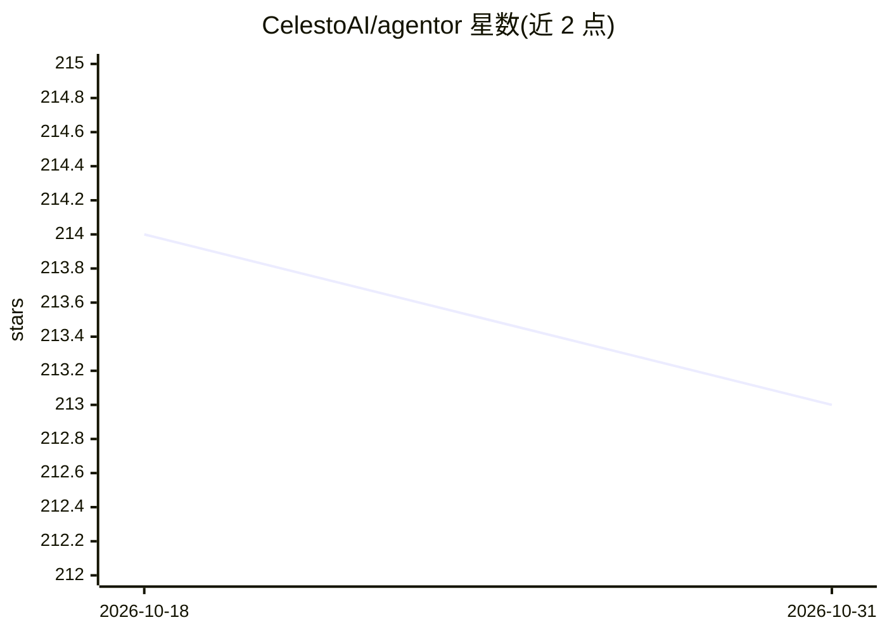

# CelestoAI/agentor

⭐ 213 · Python · Apache-2.0 · 推送 2026-10-28 · [GitHub](https://github.com/CelestoAI/agentor) · [官网](https://docs.celesto.ai/agentor) · 组织维护

**构建与部署持久化 AI Agent 的 Python 框架**

面向开发者的 Python agent 框架（pip 安装），以几行代码构建 Agent 并以 ASGI 应用形式对外提供 API。核心机制：任何 OpenAI 兼容 provider 可通过 base_url 接入（OpenRouter、Groq、DeepSeek、vLLM、Ollama 等）；durable runs 以追加式事件日志持久化运行，支持 resume 与 fork；提供 FastAPI 兼容的 LiteMCP MCP Server 构建、agent-to-agent（A2A）协议服务、Agent Skills（SKILL.md 按需加载）与可选 tracing。重型工具依赖以 extras 形式安装（google、exa、github、slack 等）。

## 筛选速览

| 维度 | 判定 | 备注 |
|---|---|---|
| AI 角色 | `ai-ecosystem` | LLM/agent 周边工具 |
| 许可风险 | `permissive` | Apache-2.0 |
| 部署形态 | `library` | 以包/库形式分发 |
| 模型依赖 | local-ok | 支持本地模型 |
| 硬件要求 | — | 无带数字的原话,不猜 |
| 安装摩擦 | `low` | 无编译、无系统依赖或容器化 |
| 成熟度 | `idea` | |

## 能力要点

- durable runs：事件日志持久化，支持 resume/fork（含异步版本）
- LiteMCP：原生 ASGI 的 MCP Server 构建与装饰器 API
- A2A 协议支持：agent.serve() 自动提供 agent card 与标准端点
- Agent Skills：SKILL.md 按需加载并在隔离 shell 执行命令

## 适用场景

- 用几行代码构建 agent 并作为 FastAPI 服务部署
- 持久化并恢复/分叉长时间运行的 agent 任务
- 构建自定义 MCP Server 或将 agent 接入 MCP 服务器
- 让多个 agent 通过 A2A 协议互操作

## 场景标签

`Agent 框架` `Agent 记忆` · 领域:Agent 开发

## 证据(README 行号)

> L59: Build an Agent, connect external tools or MCP Server and serve as an API in just a few lines of code:
> L71: Groq, Together, Fireworks, DeepSeek, vLLM, Ollama, or Anthropic's and Gemini's compatible

## 星数曲线

2026-10-18 214 → 2026-10-31 213（-1）

---
*卡片 v1 · prompt 1.4 · 生成 2026-10-22 · 置信度 high · 依据 README sha `28c52dba3bdd` · [字段定义](../../DATASET.md)*
