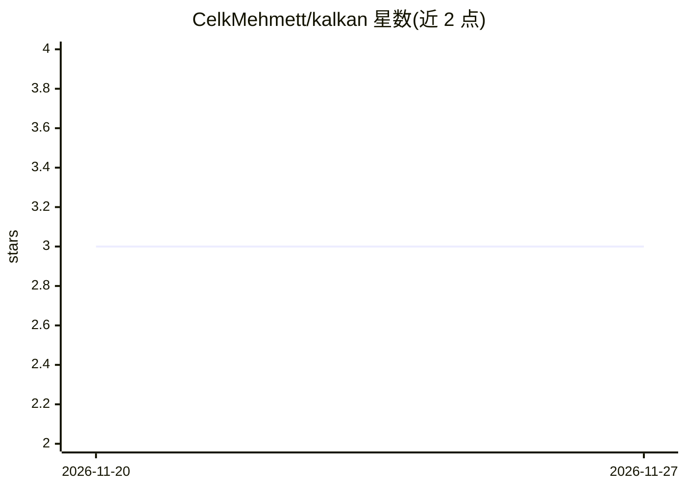

# CelkMehmett/kalkan

⭐ 3 · Rust · Apache-2.0 · 推送 2026-11-22 · [GitHub](https://github.com/CelkMehmett/kalkan) · [官网](https://celkmehmett.github.io/kalkan/) · 个人维护

**土耳其语文本 PII 掩码引擎：LLM 请求前脱敏、回复中还原**

面向 KVKK（土耳其个人数据保护法）场景的可嵌入 PII 处理引擎：在请求离开本地前将土耳其身份证号、税号、IBAN、电话、姓名等 14 类个人信息替换为占位符，LLM 回复到达后按会话 vault 还原。Rust 编写，同一引擎通过 Rust、Python（abi3 wheel）与 WebAssembly 三种形态运行，支持流式回复中跨分片占位符的还原、伪造但校验合法的合成值、以及对模型新产生 PII 的泄漏审计。提供 CLI 与 LiteLLM、LangChain、OpenAI 风格 messages 的现成适配器。README 明确声明检测覆盖率非 100%，不构成法律合规保证。

## 筛选速览

| 维度 | 判定 | 备注 |
|---|---|---|
| AI 角色 | `ai-ecosystem` | LLM/agent 周边工具 |
| 许可风险 | `permissive` | Apache-2.0 |
| 部署形态 | `library` | 以包/库形式分发 |
| 模型依赖 | — | README 未给出锁定关系 |
| 硬件要求 | — | 无带数字的原话,不猜 |
| 安装摩擦 | `medium` | 含编译或系统依赖之一 |
| 成熟度 | — | 结构信号不足 |

## 能力要点

- 14 类土耳其本地化实体检测（TCKN/VKN/IBAN 等含校验位验证）
- 流式还原：占位符跨 chunk 拆分时仍正确还原
- Synthetic 模式生成校验合法的伪造 TCKN/IBAN/卡号
- 对模型回复的泄漏审计，检测新产生 PII 与幻觉占位符

## 适用场景

- 客服聊天应用接入 ChatGPT/Claude 前对用户输入做本地脱敏
- LiteLLM Proxy 网关后挂 guardrail 保护多个应用
- 日志、通话记录、训练数据等批量匿名化任务
- 浏览器端扩展中纯本地掩码，数据不出页面

## 场景标签

 · 领域:LLM 基础设施/隐私脱敏

## 证据(README 行号)

> L37: kalkan is not a product but an **embeddable engine**: put it inside your own LLM gateway, Python
> L116: Ready-made adapters mask the prompt and restore the reply (including streaming, with

## 星数曲线

2026-11-20 3 → 2026-11-27 3（+0）

---
*卡片 v1 · prompt 1.4 · 生成 2026-11-22 · 置信度 high · 依据 README sha `09f335bf57e9` · [字段定义](../../DATASET.md)*
