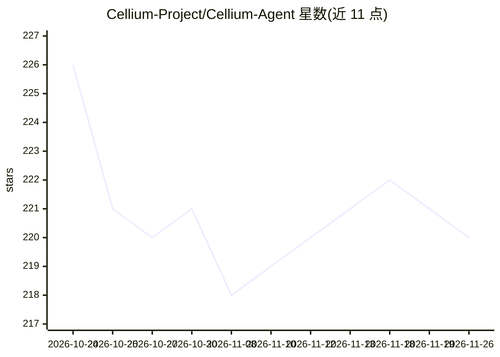

# Cellium-Project/Cellium-Agent

⭐ 220 · Python · NOASSERTION · 推送 2026-11-24 · [GitHub](https://github.com/Cellium-Project/Cellium-Agent) · [官网](https://agent.cellium.top) · 组织维护 · 中文 README

**决策环驱动的自进化通用 AI Agent 框架**

基于微内核架构（EventBus + DI + BaseTool）的通用 AI 助手框架，核心是决策环（Control Loop）配合贝叶斯 Bandit 做自学习：每轮执行特征提取、规则评估、action 选择、反馈与更新，从失败中调整策略。提供三层记忆（人格+会话+FTS5/向量长期记忆）、组件热插拔与沙箱隔离、敏感信息脱敏、会话委托与子 Agent 并行。支持 WebUI/TUI 及 QQ、Telegram、飞书、微信多通道接入，提供一键安装包、pip 与源码运行方式。

## 筛选速览

| 维度 | 判定 | 备注 |
|---|---|---|
| AI 角色 | `ai-ecosystem` | LLM/agent 周边工具 |
| 许可风险 | `none` | NOASSERTION |
| 部署形态 | `desktop` | 安装包/桌面程序 |
| 模型依赖 | — | README 未给出锁定关系 |
| 硬件要求 | — | 无带数字的原话,不猜 |
| 安装摩擦 | `low` | 无编译、无系统依赖或容器化 |
| 成熟度 | — | 结构信号不足 |

## 能力要点

- 决策环 5 阶段闭环：特征提取→规则评估→Bandit 选择→执行反馈→学习更新
- PEOP 循环：批量规划（最多 5 步）、执行内验证与局部重规划
- 三层记忆系统：FTS5 全文检索 + 可选向量嵌入混合召回，含敏感信息脱敏
- 组件热插拔（3 秒自动加载）与进程隔离沙箱，支持 QQ/Telegram/飞书/微信多通道

## 适用场景

- 通过自然语言完成文件处理、代码编写、数据分析等日常任务
- 接入 QQ/Telegram 等聊天平台作为个人 AI 助手
- 创建定时任务并自动推送结果到对应平台
- 通过组件市场安装或用自然语言生成新组件扩展能力

## 场景标签

`Agent 框架` `Agent 记忆` `AI 助手` · 领域:Agent 开发

## 证据(README 行号)

> L22: 基于微内核架构（EventBus + DI + BaseTool），支持任意 OpenAI 兼容 API
> L24: 核心设计：决策环（Control Loop）驱动的自学习 Agent，通过贝叶斯 Bandit 实现自适应决策优化。
> L160: Cellium Agent 的核心是 **Control Loop（控制环）** 驱动的决策系统，结合 **贝叶斯 Bandit** 实现自学习优化。

## 星数曲线

2026-10-24 226 → 2026-11-26 220（-6）

---
*卡片 v1 · prompt 1.4 · 生成 2026-11-25 · 置信度 high · 依据 README sha `f5da11030aa4` · [字段定义](../../DATASET.md)*
